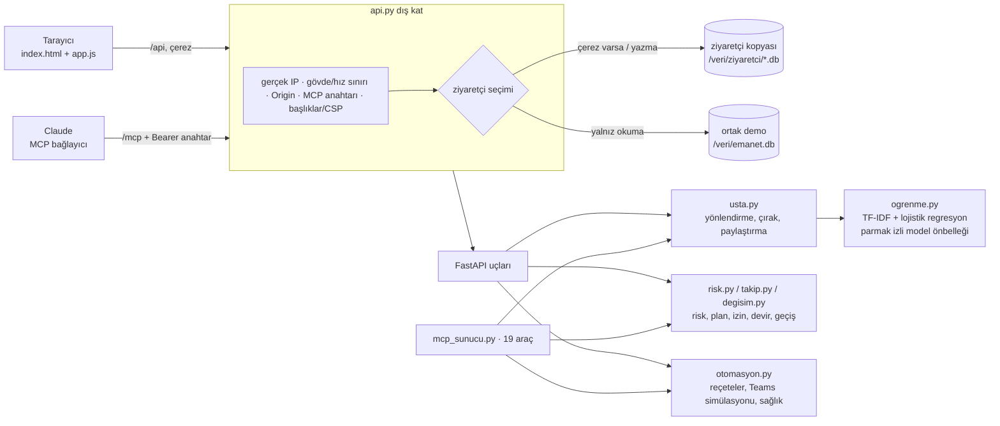
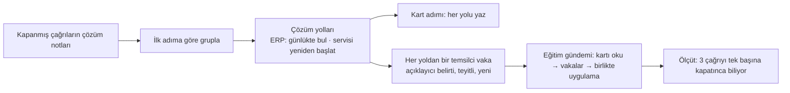
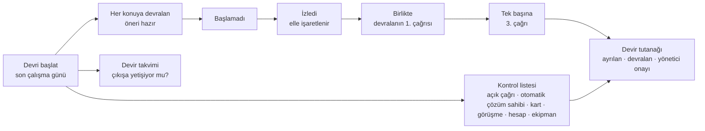
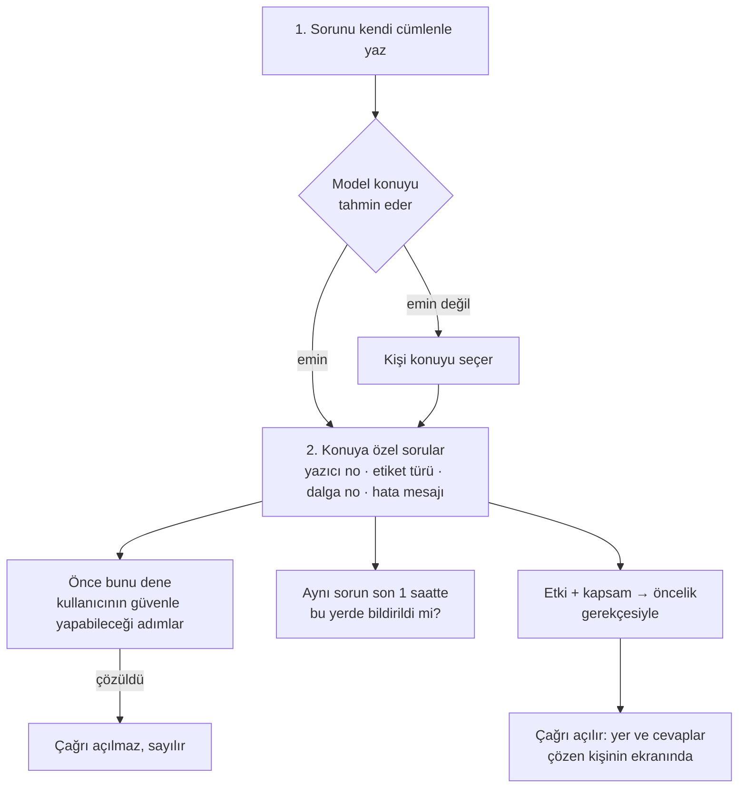
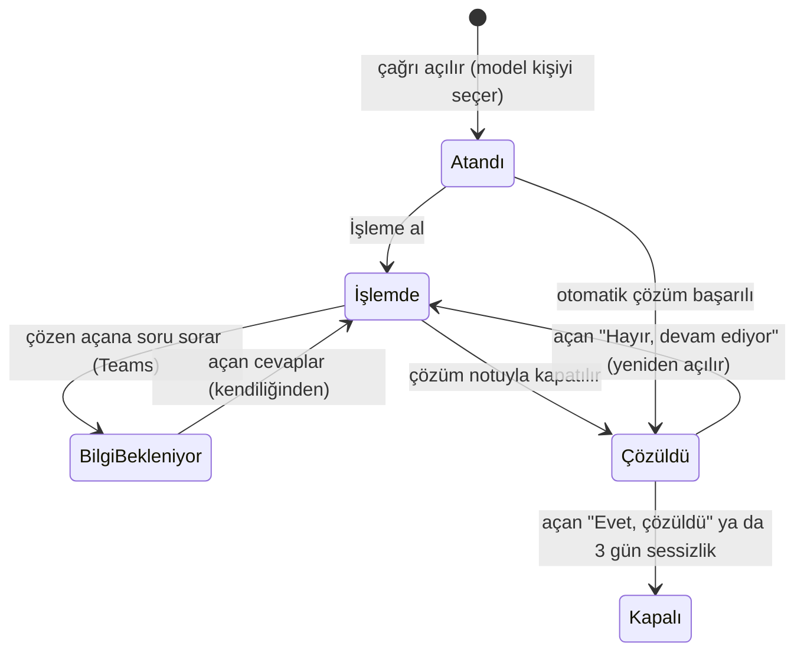

# Emanet + Usta: proje dokümanı

> Yaşayan doküman: kod değiştikçe aynı commit'te güncellenir. Derin anlatım ve 38+ soru:
> [HAKIMIYET.md](HAKIMIYET.md). Vaka anlatımı: [VAKA_NOTU.md](VAKA_NOTU.md). Ortak altyapı
> (Cloudflare, VPS, Docker, Caddy, yedek): ysfdurak.com deposu → `sunucu/README.md`,
> güvenlik kuralları → `docs/GUVENLIK_TEMELI.md`.

## 1. Bir bakışta

| | |
| --- | --- |
| **Ne** | Sistemsel destek çağrılarını geçmişten öğrenerek doğru kişiye yönlendiren (Usta) ve bu çağrılardan "kim giderse ne kırılır" haritası çıkaran (Emanet) uygulama |
| **Kimin için** | Depo/BT destek ekibi yöneticisi, İK ve eğitim birimi |
| **Canlı adres** | https://emanet.ysfdurak.com (25 Kasım 2026'da yayında) |
| **Depo** | https://github.com/ysfdurak/emanet (herkese açık; CI: testler + pip-audit) |
| **Durum** | Pilot, yayında. 83 test, güvenlik taraması temiz; MCP Claude'a bağlı |
| **Teknoloji** | Python 3.13, FastAPI, scikit-learn, SQLite, MCP, Docker |
| **Lisans** | PolyForm Shield 1.0.0 |

## 2. Sorun ve kararların

**Sorun:** Destek çağrıları çoğu zaman "en iyi bilen" kişiye gider; zamanla bilgi birkaç kişide toplanır.
O kişi izne çıkınca, ayrılınca ya da sistem değişince iş durur. Çağrı sistemleri sınıflandırır ama
bu bağımlılığı göstermez.

**Senin verdiğin kararlar** (mülakatın asıl konusu):

| Karar | Neden |
| --- | --- |
| Usta yalnız **sistemsel** çağrılara bakar (BT, WMS); teknik/bakım çağrıları ayrı sistemden gelir | Sahadaki çağrı merkezi zaten böyle ayrılmış; bakım dökümü Emanet'e ayrıca girer |
| Yönlendirme **makine öğrenmesiyle**: kime gitmiş, nasıl çözülmüş geçmişten öğrenilsin, çözene yol gösterilsin | Kural listesi eskiyor, geçmiş çağrılar bilgiyi zaten taşıyor |
| **Yetki çerçevesinde otomasyon**: kurulum talebinde eksik bilgi Teams'ten sorulsun, onay alınsın, kendisi kursun; altı akışın hepsi | Çağrıların bir kısmı tekrar eden basit işler |
| Değişimler de görülsün: **yeni otomasyon, yeni personel, yeni sistem** | Geçmişe bakan harita bu üç durumda yanılıyordu |
| Kişi modeli "kime verilirdi"yi değil **"kim iyi çözer"i** öğrensin | Aksi hâlde Usta, Emanet'in azaltmaya çalıştığı bağımlılığı besliyordu |
| Ziyaretçi **kendi çağrı verisini siteye yüklemesin**; gerçek veri yerelde denensin | Şirket verisi dışarı çıkmaz ilkesi |
| Usta ve Emanet **tek proje**, Emanet çatı adı | İki taraf aynı veriyi kullanıyor |

## 3. Mimari ve veri akışı



- **Tek çekirdek, iki kapı:** web ve MCP aynı fonksiyonları çağırır, kural tek yerde.
- **Veri:** SQLite. Demo her gece yeniden üretilir (`veri_uret.py`, sabit tohum). Gerçek veri için
  `yerel.py` boş bir veritabanına içe aktarır.

## 4. Teknoloji seçimleri

| Seçim | Neden | Elenen |
| --- | --- | --- |
| Python + scikit-learn | Model, optimizasyon ve analiz Python'da doğal; portföyün Python servis şablonuyla aynı | Node: ML kitaplıkları zayıf |
| Harf 3-5'li TF-IDF + lojistik regresyon | Türkçe ekler ve yazım hataları; yüzlerce-binlerce çağrıda en iyi denge, açıklanabilir, saniyede eğitilir | Derin öğrenme (veri az, açıklanamaz), büyük dil modeli (veri dışarı çıkar) |
| Model + açık kural (paylaştırma, çırak) | Model yetkinliği söyler, kime verileceğini kural söyler; kural okunabilir ve kapatılabilir | Olasılığı cezalandırmak: geçmiş atamalar yüzünden olasılık uzmanda yığılıyor, işe yaramadı |
| SQLite | Tek süreç, demo verisi; ziyaretçi kopyası tek dosya kopyalamak | Ortak PostgreSQL: gece silinen demo için gereksiz |
| Ziyaretçi başına veritabanı kopyası | Ziyaretçiler birbirinin metnini görmez; uçlar değişmeden (`ContextVar`) | Ortak tablo: herkes herkesin yazdığını görür |
| Dinamik programlama (eğitim planı) | Bütçeli seçim tam çözülür, açgözlü kurala göre farkı ölçülür | — |

## 5. Kod turu

| Dosya | Ne yapar | Dikkat |
| --- | --- | --- |
| `emanet/api.py` | Dış kat (güvenlik, ziyaretçi seçimi) + FastAPI uçları | `con` bir vekil nesne: her istekte o isteğin veritabanına yönlenir |
| `emanet/ogrenme.py` | Konu ve kişi modeli, kalite ağırlığı, paylaştırma kuralı, zaman bazlı değerlendirme | Önbellek anahtarı verinin parmak izi; değerlendirme bugünden önceki çağrılarla |
| `emanet/usta.py` | Konu önerisi, yönlendirme (izin, vardiya, çırak, paylaştırma), çağrı açma/kapatma | Kapanan (geçişli) konuya çağrı açılamaz |
| `emanet/otomasyon.py` | 8 reçete, Teams akışı, toplu arıza, kapanış teyidi, sağlık ve askıya alma | Yer yazılmamış çağrı yalnız yer yazılmamışlarla birleşir |
| `emanet/risk.py` | Risk puanı, ya giderse, eğitim planı, tek kişiye kalanlar, veri tazeliği | Formül dosyanın başında |
| `emanet/takvim.py` | Eğitim planını haftalara ve günlere yerleştirir (saf işlev) | Kişi başı haftalık ve günlük sınır hem vereni hem alanı kapsar; açgözlü yerleştirme, en riskli konu önce |
| `emanet/takip.py` | İzin kontrolü, plan takibi, devir dosyası, risk seyri, dikkat listesi | |
| `emanet/degisim.py` | Sistem geçişi, yeni personel, ayrılış | |
| `emanet/yerel.py` | Kendi verinle yerel kurulum ve rapor | Demo veritabanının üzerine yazmaz |
| `emanet/gercek_ip.py` | Gerçek IP yalnız güvenilen vekilden | Python servis şablonundan |
| `web/app.js` | Bütün ekranlar | Her değer `kac()` ile kaçışlanır; satır içi betik yok |

Akış örneği, "Çağrıyı aç": `app.js` → `POST /api/cagri` → dış kat (sınırlar, Origin, ziyaretçi
kopyası) → `usta.cagri_ac` → `toplu_kontrol` → `yonlendir` (model + kurallar) → `otomasyon.baslat` →
kayıtlar → JSON → ekran.

## 6. Sunucu ve yayın

Ortak altyapıdaki yeri: ysfdurak.com PR #55 (`sunucu/kurulum-emanet.sh`, Caddy bloğu, tarama listesi).
Ayrıntı: [deploy/KURULUM.md](../deploy/KURULUM.md).

1. GitHub'da `ysfdurak/emanet` deposu → kod gönderilir → dal koruması.
2. ysfdurak.com PR #54, sonra #55 birleşir.
3. Cloudflare: `emanet` A kaydı, turuncu bulut.
4. VPS: `bash ~/ysfdurak.com/sunucu/kurulum-emanet.sh` (MCP anahtarını kendisi üretir).

Ortam değişkenleri: `.env.example`. Önemlileri: `EMANET_MCP_ANAHTARLARI`, `EMANET_ZIYARETCI`,
`EMANET_DB` (kendi verinle).

## 7. Testler

`python -m pytest -q`: 83 test (model, risk, otomasyon, değişimler, paylaştırma, yerel kurulum, API
güvenliği, MCP). CI'da aynı testler ve `pip-audit`.

**Örneklem (24 Kasım 2026, yerel sunucu, mobil 390 px Chrome):**

| Adım | Beklenen | Gözlenen | Durum |
| --- | --- | --- | --- |
| 13 ekranı sırayla aç | Hata yok, CSP ihlali yok | Konsol temiz | ✅ |
| Geçiş + yeni personel + bozulma demoları | Kartlar görünür, reçete askıda | Görüldü | ✅ |
| İkinci tarayıcıdan aynı ekran | Birincinin geçişini görmez | Görmedi | ✅ |
| "Kendi demo alanımı sıfırla" | Alan başa döner | Döndü | ✅ |
| Dökümde `">` adlı kişiler | Betik çalışmaz, metin olarak görünür | Çalışmadı, metin göründü | ✅ |
| Anahtarsız `/mcp` | 401 | 401 | ✅ |
| Başka siteden POST (Origin) | 403 | 403 | ✅ |
| `tara.py --audit` (#54 sürümü) | Temiz | Temiz | ✅ |
| Sunucuda bellek (`docker stats`, boşta) | < 500 MB | 120,9 MiB / 768 MiB, CPU %0,28 | ✅ |
| Claude özel bağlayıcı (başlıkta anahtar) | Araç çağrılır, veri gelir | "En riskli konu" → ERP entegrasyon hatası, 100 puan | ✅ |
| Canlı adreste başlıklar (`curl -sI`) | CSP, HSTS | İkisi de geldi | ✅ |
| İki telefon (canlı) | Biri ötekinin çağrısını görmez | Görmedi | ✅ |

**Burada bir test daha yapalım:** boştaki 121 MiB, modeller henüz eğitilmeden ölçüldü. Birkaç
ziyaretçi gezdikten sonra `docker stats emanet --no-stream` bir kez daha bakılmalı (250–350 MB
normal; 768 MB sınırına yaklaşırsa model önbelleği 6'dan 3'e indirilir).

**Ders (yayın günü):** MCP anahtarı ilk denemede bağlayıcı adresine yazılıp ekran görüntüsüyle
paylaşıldı; anahtar hemen yenilendi. Doğrusu: adres `https://emanet.ysfdurak.com/mcp`, anahtar
**İstek başlıkları** bölümünde `Authorization: Bearer <anahtar>`. Başlık değeri Claude'da şifreli
saklanır ve bir daha gösterilmez; adres ise ekranda, kayıtlarda ve ekran görüntülerinde görünür.
Anahtar yenileme:
```bash
cd ~/emanet && sed -i "s|^EMANET_MCP_ANAHTARLARI=.*|EMANET_MCP_ANAHTARLARI=$(openssl rand -hex 32)|" .env
bash ~/ysfdurak.com/sunucu/kurulum-emanet.sh
```

## 8. Bilinen sınırlar ve sonraki adımlar

- Sentetik veride başarı yüksek (konu %91); gerçek veride düşük çıkabilir: `python -m emanet.yerel` ile ölç.
- Otomasyonlar simülasyondur (Teams, Intune, Active Directory bağlantısı yok).
- Paylaştırma ve kalite ağırlığının etkisi demo verisinde küçük (bkz. HAKIMIYET 2b).
- **Şöyle daha iyi olur:**
  - Arıza Defteri yayına çıkınca bakım dökümü elle yüklemek yerine oradan okunabilir (Caddyfile'da
    bu bağlantı için not var).
  - Gerçek veri gelince anlam benzerliği için yerel bir cümle modeli eklenebilir.
  - Ziyaretçi demosundaki model eğitimi isteği bekletiyor (ilk kapanışta 1-2 sn); arka plana alınabilir.

### Eğitim neyi gösterir, süreler nereden gelir? (alan uzmanı gözüyle düzeltme)

Kullanıcının eleştirisi: "Kart 2 saat gerçekçi değil; kart ne, eğitimde ne gösterilecek?" Haklıydı: kart yazma
süresi koddaki sabitti (`KART_YAZMA_SAATI = 2`), öğretme süresi katalogdaki tahmindi ve planın "10 saat
öğretir" dediği saatlerde ne yapılacağı hiçbir yerde yoktu.

**Kart nedir:** konunun yazılı çözüm talimatı ("bu hata çıkarsa şunu yap", adım adım). Bilen kişi yokken
başkası kartla çözebilsin diye.

**Eğitimin içeriği eski çağrılardan çıkar (`emanet/egitim.py`):**



- **Çözüm yolu:** notlar ilk adımlarına göre gruplanır; her grup bir yol, kaç çağrıda kullanıldığıyla.
- **Temsilci vaka:** her yoldan, belirtisi en açıklayıcı olan (konunun anahtar kelimesini içeren,
  "çalışmıyor, acil bakar mısınız" gibi genel olmayan) eski çağrı. Ekranda çağrının kendisine bağlantı var.
- **Gündem oturumlara dağılır** (`takvim.oturum_gundemi`): ilk oturumlar kart ve vakalar, kalanlar "birlikte
  uygulama". Takvimde ve Excel'de her oturumun ne yapacağı yazar.
- **Tamamlanma beyanla değil çağrıyla ölçülür:** öğrenen 3 çağrıyı tek başına kapatınca "biliyor".

**Süreleri kullanıcı girer:** Eğitim planı → "Konu süreleri" tablosu (kart yazma, öğretme; yarım saatin katı).
Girilmeyen konu tahminle hesaplanır ve planda **"tahmini süre · düzelt"** diye işaretlenir; yeni açılan konu
süresi girilene kadar tahminidir. Riskli bir konunun süresi yoksa Bugün sayfasında "Süreleri gir" uyarısı çıkar.
Tazeleme öğretmenin üçte biri, yeni sisteme geçiş yarısı sayılır. Optimizasyon yarım saatlik süreler için
yarım saat biriminde çalışır (sırt çantası dizisi 2 × bütçe uzunluğunda).

**Demo süreleri (alan uzmanı gözüyle, `katalog.UZMAN_SURELERI`):** kullanıcı süreleri depo/BT destek ve
bakım tecrübesi olan birinin gözüyle yazmamı istedi. Varsayımlar: süreler **temas saatidir** (usta ile
öğrenenin birlikte geçirdiği ya da ustanın yazıya ayırdığı süre; takvim bunu haftalara yayar); öğrenen **aynı
birimden, temel işi bilen** biridir. Kart: her çözüm yolu için ekran görüntülü/fotoğraflı adımlar ve bir
okuma-düzeltme turu. Öğretme: vakaların üzerinden geçmek ve öğrenen 3 işi tek başına yapana kadar gözetimli
uygulama. Tazeleme bunun üçte biri, yeni sisteme geçiş yarısıdır.

| Konu | Kart | Öğretme | Gerekçe |
| --- | ---: | ---: | --- |
| El terminali bağlanmıyor | 1,5 sa | 3 sa | Üç-dört yol (Wi-Fi profili, uygulama önbelleği, yedek cihaz); cihazı tanıyan biri MDM ekranını yarım günde öğrenir |
| Etiket yazıcısı yazdırmıyor | 2 sa | 4 sa | Ribon/etiket ayarı, kalibrasyon, kuyruk; fotoğraf gerekir. Kalibrasyon ve şablon elle denenerek öğrenilir |
| Şifre ve hesap kilidi | 0,5 sa | 1 sa | Tek ekran, tek akış; kimlik doğrulama kuralı en önemli kısmı |
| Kablosuz ağ kopması | 2 sa | 12 sa | Kontrolör ekranı, erişim noktası ve dolaşım (roaming) sorunları ağ bilgisi ister; iki saha turu dahil |
| Bilgisayar ve ekran arızası | 1 sa | 2 sa | Destek uzmanının temel işi; yalnız depo cihazlarına özgü noktalar |
| E-posta ve takvim sorunu | 1 sa | 1,5 sa | Standart ofis sorunları |
| Yazılım kurulum talebi | 1 sa | 2 sa | Kurulumdan çok lisans ve onay akışı öğrenilir |
| Yetki ve erişim talebi | 1,5 sa | 3 sa | Rol matrisi ve onay kuralları; yanlış yetki riski yüzünden gözetim süresi uzun |
| WMS adres ve yerleştirme hatası | 2 sa | 8 sa | Lokasyon ana verisi ve yerleştirme kuralları; WMS'i kullanan biri için bir iş günü |
| Stok uyuşmazlığı | 3 sa | 16 sa | Hareket izleme, sayım düzeltme, ERP mutabakatı; finansal etkisi var, düzeltme onaylı yapılır |
| Sipariş dalgası açılmıyor | 3 sa | 20 sa | Üç yol (tahsis/rezerv, kilitli dalga işi, şablon kesim saati); dalga ve tahsis mantığı vardiya baskısı altında öğrenilir |
| Barkod okunmuyor | 1 sa | 3 sa | Okuyucu ayarı ve etiket kalitesi; çoğu sahada görülerek öğrenilir |
| ERP entegrasyon hatası | 4 sa | 32 sa | Mesaj kuyruğu, entegrasyon günlüğü, belge yeniden gönderme; yanlış yeniden gönderme mükerrer kayıt yaratır. ERP-WMS veri modeli nadir bilgi |
| Rapor ve küp yenilenmiyor | 1,5 sa | 6 sa | Zamanlanmış yenileme, kaynak bağlantısı, kapasite; raporlama bilen biri için |
| Sorter arızası | 6 sa | 40 sa | Sensör/fotosel hizalama, sıkışma, PLC hata kodları ve kilitleme-etiketleme (LOTO) adımları fotoğraflı; elektromekanik + PLC okuma, gözetimli 3 arıza |
| Raf hasarı | 2 sa | 4 sa | Hasar sınıfı (yeşil/sarı/kırmızı) ve bölge kapatma kuralı; karar vermeyi öğrenmek önemli |
| Forklift ve akü arızası | 1,5 sa | 6 sa | Akü değişimi ve şarj güvenliği uygulamalı öğrenilir |
| Konveyör durması | 3 sa | 16 sa | Motor, kayış, sensör ve hat kontrolü; durma nedenini ayırt etmek tecrübe ister |
| Streç ve paketleme makinesi | 1,5 sa | 4 sa | Film takma, gerdirme ayarı, sık arızalar |
| Rampa ve kapı arızası | 2 sa | 6 sa | Hidrolik rampa ve seksiyonel kapı; güvenlik kilitleri |
| İş kıyafeti ve koruyucu ekipman | 0,5 sa | 0,5 sa | Stok ve dağıtım listesi |
| Servis ve yemek | 0,5 sa | 0,5 sa | İletişim listesi ve değişiklik akışı |
| Vardiya ve izin talebi | 1 sa | 1,5 sa | İK sistemi ekranı ve onay kuralları |
| Giriş kartı ve turnike | 1 sa | 1,5 sa | Kart tanımlama ekranı ve kayıp kart akışı |
| İş kazası ve ramak kala | 2 sa | 6 sa | Bildirim akışı ve yasal süreler, kayıt, kök neden; yanlış bildirim yasal risk |
| Yangın ve sıcaklık alarmı | 3 sa | 10 sa | Alarm paneli, bölge tespiti, yanlış alarm ayrımı, soğuk oda sapma prosedürü, kime haber verilir; yangın eğitimi ayrıca gerekir |
| Dökülme ve temizlik | 1 sa | 1 sa | Malzemeye göre temizlik ve atık kuralı |
| Hasarlı ürün | 1 sa | 2 sa | Ayırma, kayıt, iade/imha kararı |

**Bu sürelerin plana etkisi (demo):** 60 saatle Sorter arızasına yalnız kart yazılabiliyor (öğretmek tek başına
40 saat); kırmızı konular yine sıfırlanıyor ama takvim haftada 2 saatle 12 hafta sürüyor ve süreyi Elif
(20 saat öğretme) belirliyor. 120 saatle Sorter öğretimi de girer, takvim 23 haftaya uzar. **Şöyle daha iyi
olur:** Sorter gibi 40 saatlik bir konu için haftalık 2 saat sınırı gerçekçi değil; bu tür konularda
üretici eğitimi ya da yoğun bir hafta (Takvimde "bu hafta kişi başı +") planlanmalı.

**Mülakat sorusu:** *"Süreyi neden veriden hesaplamadın?"* Veriden kart yazma süresi çıkmaz; kimse bunu
kaydetmiyor. Uydurulmuş bir sayı planı gerçekçi gösterir ama yanıltır. Bu yüzden süre işi bilen kişiden
gelir, girilmeyen her yer açıkça "tahmini" diye işaretlenir.

### Devir süreci (rapordan sürece)

Eleştiri: "Devir dosyası için farklı bir yol olmalı." Eski devir dosyası tek seferlik bir rapordu; gerçekte
devir, son çalışma gününe kadar süren bir süreç. Yeni `emanet/devir.py`:



- **Aşamalar beyanla değil çağrıyla ölçülür.** "İzledi"yi sistem göremez, elle işaretlenir; devralanın devir
  başladıktan sonra kapattığı ilk çağrı "birlikte", üçüncüsü "tek başına". Devirden önceki çözümler ayrı
  sayılır: devralan konuyu zaten biliyorsa (90 günde eşik kadar çözüm) konu baştan tamam sayılır ve ekranda
  tek satırlık özete iner; dikkat riskli konulara kalır.
- **Devralan gerçek çağrı alır.** Yanında öğrenme kritik konularda kapalıydı (ERP, dalga, sorter). Devir
  sürerken bu konularda devralana açıldı: usta ayrılıyorsa devralanın pratiğe başka yolu yok. Devralan
  ustadan farklı vardiyadaysa ekran uyarır: "vardiyaları birkaç gün çakıştırın".
- **Çıkışa yetişiyor mu?** Kalan kart ve öğretme saatleri (aşamaya göre azalır; tazeleme üçte bir) ayrılan
  kişinin haftalık devir saatiyle (varsayılan 4) bugünden itibaren takvime yerleşir. Yetişmeyen konu
  varsa sistem yetişecek haftalık saati hesaplar ve tek düğmeyle uygular ("Haftada 5 saate çıkar"); 20
  saat bile yetmiyorsa konuyu bölmeyi ya da çıkışı ertelemeyi önerir.
- **Kontrol listesi:** açık çağrılar ve kart kendiliğinden ölçülür; ayrılanın bakımını yaptığı otomatik
  çözümler tek tıkla yeni sahibe verilir; kartı yalnız ayrılan kişinin asıl ustası olduğu konularda (çözümlerin
  ≥ %40'ı) o yazar; hesaplar ve ekipman elle işaretlenir.
- **Bilgi aktarım görüşmesi:** beş soru (sık sorunlar, yazılmamış püf noktaları, dışarıdan kimler aranır,
  dönemsel işler, yarım kalanlar). Çağrılardan çıkmayan bilgi buradan gelir.
- **Tutanak:** Markdown; konular, aşama ve kanıtı, liste, görüşme, açık riskler ve imza tablosu.
- Bugün sayfası süren devirleri gösterir (yetişmiyorsa kırmızı). MCP: `devir_baslat`, `devir_durumu`.
- DEMO: "2 hafta ilerlet" bilerek karışık sonuç üretir (iki haftada "tek başına" gerçekçi değil).

**Mülakat sorusu:** *"Devralanın öğrendiğini nasıl anlıyorsun?"* Beyana bakmıyorum: devir başladıktan sonra
o konuda kendi kapattığı çağrı sayısına bakıyorum. Yalnız "izledi" elle, çünkü izlemeyi kayıt göremez.

**Kullanıcı gözüyle ikinci bakış (25 Kasım):** telefonda devir sayfası 4813 px'ti; altıda biri aynı cümleyi
tekrarlayan takvimdi. Düzeltmeler: üstte **"Bu hafta"** kutusu (oturumlar ve bekleyen işler: izleme,
açık çağrılar, görüşme); takvimde ilk iki hafta açık, kalanı açılır bölümde ve aynı işin cümlesi bir kez;
görüşme açılır bölümde ("0/5 soru cevaplandı"); durum satırı dürüst ("0/1 konu devredildi, 5 konuda devralan
zaten biliyor"; eskiden "5/6" yazıyordu, ilerleme var gibi görünüyordu); madde dili düzeltildi ("Açık
çağrıları devredilsin" → "Açık çağrılar başkasına atansın"). Sonuç: 4813 → 2959 px, 797 → 486 kelime.

**Alan uzmanı gözüyle: kartı devralan yazar, ayrılan düzeltir (onaylandı, uygulandı).** Eskiden ayrılan kişi
ilk 1,5 haftayı kartı tek başına yazmaya harcıyor, devralan ikinci haftada başlıyordu. Şimdi kart yoksa ve
devralan seçiliyse takvimde üç adım var:

| Adım | Kim | Süre | Neden |
| --- | --- | --- | --- |
| Kart taslağı | Devralan, tek başına | kart süresi (ERP 4 sa) | Vakaları tek tek açıp yazarken öğrenir; vardiya çakışması gerekmez |
| Düzeltme | Ayrılan + devralan | kartın yarısı (2 sa), taslaktan **sonra** | Eksik adımlar, yazılmamış püf noktaları, kime sorulur |
| Öğretme | Ayrılan + devralan | kalan − kart süresi (en fazla yarısı düşer) | Vakalar taslakta geçildi, tekrar edilmez; "birlikte uygulama" gerçek çağrı ister, kısalmaz |

Takvime bunun için "önceki adım bitmeden başlama" kuralı eklendi (`takvim.py`, satırdaki `onceki`).
Murat örneği: ayrılanın devir saati 15 → 9; takvim 15 Aralık'ta bitiyor (çıkış 16 Aralık), haftalık saati
artırma uyarısı kalktı. Bedeli: devralanın yükü artar (11 → 13 saat); ama bu saat zaten onun gelecekteki işi.

**Devralanın ayrı haftalık sınırı.** Ayrılan ve devralan aynı sınırı paylaşıyordu; oysa devralanın da günlük
işi var. Artık ikisi ayrı (`devir.devralan_sinir`, varsayılan 4; takvimde `kisi_sinir`). Takvim yetişmiyorsa
öneri sırası: önce ayrılanın saati, yetmezse devralanınki, o da yetmezse ikisi birden (en fazla 20).
Ekran süreyi kimin belirlediğini söyler: "Süreyi Emre Çelik belirliyor: 13 saat, haftada 4 saatle en az 4 hafta."

**Çağrı formu, kullanıcı gözüyle ikinci bakış:** telefonda ikinci aşama 1027. pikselden başlıyordu; sorular
açıldığında kullanıcı fark etmiyordu. Metin yazılınca örnek cümleler gizleniyor (ikinci aşama ~800 px'e çıktı)
ve sorular hâlâ görünmüyorsa tahminin altında "6 kısa soru açıldı ↓" düğmesi çıkıyor. Kuyrukta çağrının yeri
görünüyor. Yetki ve kurulum talebinde "Nerede?" sorulmuyor.

### İki aşamalı çağrı formu

Eleştiri: "Çağrı açma kısmı fazla basit." Eski form tek metin + kişinin seçtiği aciliyetti. Sorunları:
herkes "yüksek" seçer; çözen kişi ilk iş geri arayıp "hangi yazıcı, nerede?" diye sorar; aynı arıza beş kez
açılır; ribonu biten yazıcı için bir uzmanın işi bölünür. Yeni akış (`emanet/cagri_formu.py`):



- **Öncelik sorulmaz, hesaplanır.** BT hizmet yönetimindeki etki x aciliyet matrisinin sahaya uyarlanmışı:
  işin durumu (durdu 3, yavaşladı 2, etkilemiyor 1) + kimi etkiliyor (ben 1, ekip 2, bütün alan 3); 5-6 Yüksek,
  4 Orta, aşağısı Düşük. **Bekleyen araç ya da sevkiyat saati** varsa iş etkilendiği sürece Yüksek (depoda
  asıl maliyet kaçan araçtır). Kritik konuda iş durduysa en az Orta. Gerekçe ekranda düz cümle:
  "İş tamamen durdu + yalnız ben + bekleyen araç var → Yüksek". Sunucu kendi hesaplar; gönderilen `aciliyet`
  form alanlarıyla birlikte yok sayılır (kimse "yüksek" yazıp öne geçemez).
- **Talep arıza değildir.** Yazılım kurulumu ve yetki talebinde "iş durdu mu" yerine "ne zamana lazım" sorulur;
  en fazla Orta. Yetki talebi onaylayan yöneticiyi ister (gerçekte onaysız yetki verilmez). Yer sorulmaz.
- **Sorular tanı koydurur.** Örn. el terminali: "Başka bir terminal denedin mi?" İkisi de çalışmıyorsa sorun
  cihazda değil ağda ya da sistemde; çözen kişi ilk adımı atlar. Sorusu tanımlanmamış yeni konu genel iki soru alır.
- **Cevaplar metne eklenmez.** Metin modelin öğrenme verisi; form cümleleriyle kirlenmesin diye cevaplar
  `cagri.ek_bilgi` (JSON, soru metniyle) ve `cagri.yer` sütunlarında durur. Soru listesi sonradan değişse de
  eski kayıt okunur kalır. Seçim cevabı seçeneklerden biri olmalı; metin cevabı 200 karakterle kesilir.
- **Aynı sorun uyarısı:** aynı konuda son 60 dakikada açık çağrı varsa (yer yazıldıysa aynı yer ya da yeri
  bilinmeyen) "zaten bildirilmiş olabilir" listesi çıkar. Engellemez: üç kişi bildirince toplu arıza tek kayda
  birleşir. Toplu kontrol artık formdaki yeri de kullanır (eskiden yalnız metinde geçen yeri arıyordu).
- **"Önce bunu dene" çözüm notlarından türetilmedi.** Notlar uzmanın uzmana yazdığı adımlar ("entegrasyon
  günlüğünde belgeyi bul"); çağrıyı açan depo çalışanı bunları yapamaz. Bu yüzden yalnız kullanıcının güvenle
  yapabileceği adımlar elle yazıldı (ribon/kapak, kapat-aç, yan göze bak). "Bununla çözüldü" denirse çağrı
  açılmaz ve konu başına sayılır (açılmayan çağrı ölçüsü). Konuda otomatik çözüm varsa form bunu söyler.
- Çağrı detayında yer, cevaplar ve öncelik gerekçesi görünür. MCP `cagri_ac`: `yer`, `etki`, `kapsam`,
  `sevkiyat`, `cevaplar` parametreleri; sonuçta öncelik gerekçesi ve sorulmayan sorular döner (Claude
  kullanıcıya eksikleri sorabilsin).

**Cihaz numarası ve tekrarlayan arıza (kullanıcı isteği):** "Yazıcı modeli bilinmeli, el terminalinde cihaz
no izlemek için gerekli." Yazıcı ve terminal numarası artık **gerekli** ve ayrı sütunda (`cagri.cihaz`) durur.
- Numara tek biçime gelir: "yz 7", "YZ07", "yz-007" → `YZ-07` (aynı cihaz farklı yazılınca geçmişi bölünmesin).
- **Envanter:** numara kayıtlıysa model ve yer kendiliğinden gelir, model sorulmaz (`katalog.CIHAZLAR`; demo).
  Kayıtlı değilse model sorulur. Gerçekte envanter demirbaş sisteminden içe aktarılır.
- Numara yazılınca formda o cihazın son 90 günü görünür; 30 günde 3 ve üzeri çağrı **tekrarlayan arıza**
  sayılır. Çözen kişi çağrı detayında cihazın geçmişini (ne oldu, nasıl çözüldü) görür. Bugün sayfası
  tek satırda uyarır; "Cihaz geçmişi" sayfası tekrarlayanları listeler. MCP: `cihaz_gecmisi`.
- Alan uzmanı notu: tekrarlayan arızada her seferinde onarmak yerine değişim, bakım sözleşmesi ya da kök
  neden (ribon sensörü, pil) konuşulur. Bu kararın verisi ancak numarayla tutulursa oluşur.
- Demo verisinde numaralar metinle çelişmesin diye: metinde yer geçiyorsa o yerdeki yazıcı, "17 no'lu"
  geçiyorsa o numara verilir; irsaliye (A4) yazıcısı ve yazım hatalı yerler numarasız kalır.
  Demo veri biçimi değişince sunucu gece beklemeden yeniden üretir (`VERI_SURUMU`).

**Cihaz çoksa nasıl tutulur? (kullanıcı sorusu)** Envanter koddaki sabit listeden veritabanına taşındı
(`cihaz` tablosu: no birincil anahtar, tür, model, yer, seri no, durum aktif/hurda). Binlerce cihaz SQLite
için küçük bir tablodur; numara anahtar olduğu için arama ve çağrıyla eşleştirme anında olur.
- **Kaynak:** demirbaş sisteminden CSV (Cihaz geçmişi → Envanteri içe aktar). Sütun adları esnek ("Cihaz No",
  "Konum"); numara tek biçime gelir; var olan güncellenir. "Tam liste" işaretlenirse listede olmayan aktif
  cihazlar hurdaya ayrılır (kısmi listede işaretlenmez, yoksa envanter silinmiş gibi olur).
- **Envanterde olmayan numaralar** ayrı listelenir: yazım hatası ya da envantere girmemiş yeni cihaz.
  Sistem bunları kendisi eklemez; envanterin sahibi demirbaş sistemidir.
- **Çok cihazda tek tek değil gruba bakılır:** modele göre cihaz başı çağrı (son 90 gün). Türün ortalamasının
  iki katı ve en az 5 çağrı varsa "Model sorunu?" işareti: sorun tek cihazda değil modelde olabilir.

**Çağrı durumları (kullanıcı isteği):** "açık, atandı, çözüldü, kapalı gibi; soru ya da cevapla güncellenmeli."



- İki katman: kaba durum (`durum`: açık/kapalı) öğrenme ve risk hesabının kullandığı; ince durum (`asama`)
  iş akışı. "Çözüldü" kaba durumda kapalıdır, çünkü çözen ve not bellidir; onay gelmezse 3 gün sonra kapanır.
- Her geçiş çağrı geçmişine "Atandı → İşlemde" biçiminde yazılır (kim, neden). Yeni yazılan her ekleme yolu
  (döküm, eski kod) durumu bir veritabanı tetikleyicisiyle alır; eski veriye göç tek UPDATE.
- Kuyruk duruma göre süzülür; detayda adım çubuğu, "kim ne bekliyor" cümlesi, "İşleme al" ve "Açana soru sor".
  MCP: `cagri_islem` (işleme al, soru), `cagrilari_listele` ince durumla.
- Alan uzmanı notu: "Bilgi bekleniyor"da top açandadır; ileride çözüm süresi ölçülürken bu süre çözene
  yazılmamalı (SLA duraklatma). Şimdilik süre ölçümü değişmedi.

**Ölçüler (kullanıcı isteği: "kapatma süreleri, üzerine aldığı çağrı sayısı gibi metrikleri görmek gerek").**
Çağrılar → Ölçüler, son 7/30/90 gün (`emanet/olcum.py`, `/api/olcumler`, MCP `cagri_olculeri`):
- **Özet:** açılan/kapanan, kapanma süresi ortanca ve %90'lık dilim, ilk seferde çözülen (yeniden açılmayan)
  pay, şu an açık (bilgi bekleyen, onay bekleyen), en eski açık çağrının yaşı, açanın "çözüldü" dediği pay.
- **Kimin üzerinde ne var:** kişi başı üzerindeki açık çağrı (başlanmadı, işlemde, bilgi bekliyor, yüksek
  öncelik), en eskisinin yaşı, dönemde kapattığı, ortanca süre, konuya göre hız, yeniden açılan. "Yük fazla":
  en az 3 açık ve ekip ortalamasının iki katı. Telefonda tablo yerine kart.
- **Haftalık akış** (açılan ve kapanan; sürekli açılan fazlaysa iş birikiyor) ve **konulara göre** süreler.

Alan uzmanı kararları:
- **Ortalama değil ortanca:** birkaç günlük çağrı ortalamayı bozar. %90'lık dilim "kötü günleri" gösterir.
- **Ham süre karşılaştırılmaz:** ERP çağrısı şifre çağrısından uzun sürer; kişinin hızı konunun tipik süresine
  bölünür (1,0 = tipik). Yoksa zor işleri alan kişi "yavaş" görünür ve kimse zor işi almak istemez.
- **Yarış tablosu değil:** kişiler ada göre sıralı. Amaç iş yükünü dengelemek ve yardıma ihtiyacı olanı görmek.
  (Depoda rekabet temelli uygulamaların tutmadığı geri bildirimiyle de uyumlu.)
- **Net süre:** "Bilgi bekleniyor"da geçen süre (top açandayken) çözenin süresinden düşülür.

**Süre nereye gitti (kullanıcıyla kararlaştırıldı: 6 gün, 3 vardiya, pazar kapalı).** Toplam süre dörde
ayrılır (`olcum.parcala`): **çalışma** (çözenin vardiyasında ve izinde değilken), **vardiya beklemesi**
(çözen vardiyada ya da işte değilken), **bilgi bekleme** (top açanda), **depo kapalı** (pazar).
- Kişi ölçüleri (ortanca, konuya göre hız) yalnız çalışma süresiyle. Vardiya beklemesi kişinin değil
  kapsamanın süresi: konu bazında toplanır. Demoda en çok Sipariş dalgası (≈36 saat/30 gün) ve ERP bekliyor;
  ikisi de risk haritasında tek kişiye bağlı konular. Yani risk puanının saatle ölçülmüş kanıtı. Bugün
  sayfası 8 saati geçen konuyu "başka vardiyada bilen yetiştirin" diye uyarır, eğitim planına bağlanır.
- **İlk tepki:** atanmadan "İşleme al"a kadar geçen hizmet süresi (çalışma + vardiya beklemesi).
- **Öncelik hedefleri** kullanıcıdan gelir (ilk tepki dk, çözüm saat; `meta.oncelik_hedefleri`); girilmeyen
  öncelikte hedef yok. Hedefler açanın gözünden ölçülür: çalışma + vardiya beklemesi (bilgi ve pazar hariç).
  Ekran dönemde aşanları ve şu an hedefi geçmiş açık çağrıları sayar.
- Pazar kaydırması yalnız geçmiş günlere uygulanır; sıfırlama pazar çalışırsa bugünün çağrıları geleceğe kaymaz.

Demo verisi: geçmiş çağrıların %82'sinde açan onaylamış; kişi başına %1-8 çağrı ilk çözümden sonra yeniden
açılmış (ayrı tohum; `VERI_SURUMU` 4). Bilinen sınır: süreler takvim dakikasıdır, vardiya dışı saatler düşülmez.

**Ana kategori ve tesis (kullanıcı isteği: "donanım, yazılım, ağ gibi kategoriler; birden fazla lokasyondan çağrı").**

*Çağrı alanı* (kullanıcının düzeltmesiyle): ilk sürümde konuları "Cihaz, Ağ, Program…" diye grupladım; kullanıcı
katılmadı: "terminal donuyorsa sistemsel, açılmıyorsa donanımsal; WMS ve ERP için ayrı alanlar olup ilgili kişilere
düşsün, donanıma bakan yalnız donanım çağrılarını halletsin." Doğru olan konuya göre değil **işe hangi ekip
bakar**a göre ayırmaktı. Yeni yapı:
- Alanlar ve ekipleri (`katalog.ALANLAR`, `kisi_alan` tablosu): Donanım, Ağ, WMS, ERP ve raporlama, BT genel.
  Bir kişi birden çok alanda olabilir. Atama alan verildiğinde birime değil o alanın ekibine bakar.
- **Alan belirtiden belirlenir** (`cagri_formu.alan_bul`, `katalog.BELIRTI_ALANI`): el terminalinde "Açılmıyor,
  Şarj olmuyor, Ekran kırık" → Donanım; "Ekran donuyor, Oturum açılmıyor" → WMS; "Ağa bağlanmıyor" → Ağ.
  Sıra: belirti cevabı > kişinin seçtiği alan > konunun varsayılan alanı. Belirti öne geçer, çünkü çalışan
  alanı yanlış tahmin edebilir; ekran bunu açıkça yazar ("WMS · cevabına göre (seçtiğin Donanım yerine)").
- Formda alan isteğe bağlı seçilir ve tahmini daraltır (o alana düşebilecek konular, ör. WMS = dalga, adres,
  stok + terminal donması); olasılıklar **yeniden ölçeklenmez** (sahte kesinlik yok). İkinci aşamada
  "Gideceği ekip" satırı cevaplarla canlı değişir, atama önizlemesi de onunla.
- Çağrı alanı kaydedilir (`cagri.alan`); yerinde atama ve tesis kapsaması alana göre (Donanım, Ağ).

*Yanlış yönlendirme* (kullanıcıyla kararlaştırıldı; `emanet/yonlendirme.py`, `aktarim` tablosu):
- **"Bu benim işim değil"** (çağrı detayı): neden *yanlış ekip* (doğru ekip ya da "Bilmiyorum") ya da *yanlış
  konu*. Bilgi eksikse aktarılmaz; açana soru sorulur (Bilgi bekleniyor).
- **Geri değil ileri:** doğru ekipte vardiyadaki en uygun kişiye gider; gönderen aday olmaz (`yonlendir(haric=)`),
  açana "yanlış seçmişsin" denmez.
- **Top oynatma kuralı:** ikinci aktarım ya da "Bilmiyorum" → **BT müdürü** (demo: Levent Arıkan; `kisi.koordinator=1`,
  ona çağrı atanmaz). Müdürün kişi seçmesi son karardır, aktarım sayılmaz. Bugün: "N çağrı kararını bekliyor".
- **Süre adaleti:** yanlış ekipte geçen süre "yönlendirme kaybı" olarak ayrı gösterilir; çözenin süresi son
  aktarımdan başlar.
- **Şeffaflık:** sistemin kendi değişikliği geçmişe yazılır ("Sistem alanı cevaba göre Donanım yerine WMS yaptı").
- **Kural önerisi:** aynı belirti 90 günde en az 3 kez ve aynı belirtili çağrıların %30'undan fazlasında aynı
  ekibe aktarıldıysa Ölçüler'de öneri çıkar; "… ekibine çevir" ya da "Böyle kalsın" (insan kararı, `meta`
  `belirti_kurali` / `belirti_kurali_red`). Demo hikâyesi: "Ekran donuyor" kuralı WMS'e gönderir ama eski
  terminallerde donma çoğu zaman donanımdır (şişmiş pil); 9 çağrının 4'ü donanıma aktarılmış.
- Ölçüler → Yönlendirme: ekibe göre aktarım oranı, müdürde bekleyenler, öneriler. MCP `cagri_aktar`.

*Tesis* (`lokasyon` tablosu; kişi, çağrı ve cihaz bir tesise bağlı). Tesis, tesisin içindeki **yer**den
(koridor, rampa) ayrı bir katmandır. Demo: Gebze Merkez, Tuzla Aktarma, İzmir Bölge; Tuzla'da Onur (akşam),
İzmir'de Gizem (gece) yerinde BT.
- **Atama:** cihaz ve ağ işleri yerinde bakılır (`YERINDE_GRUPLAR`). Tesiste vardiyada konuyu bilen varsa ona
  gider; yoksa uzaktan en uygun kişiye gider ve not düşülür ("Tuzla'da şu an yerinde kimse yok (Onur akşam
  vardiyasında); uzaktan yönlendirildi"). Program ve hesap işleri uzaktan çözülür, tesis atamayı değiştirmez.
- **Toplu arıza ve "zaten bildirildi"** tesis bazında: Gebze'deki Wi-Fi arızasıyla İzmir'deki ayrı olaydır.
- Form tesisi tarayıcıda hatırlar; cihaz numarası başka tesiste kayıtlıysa tesis cihaza göre değişir.
- Kuyruk ve Ölçüler tesise göre süzülür; Ölçüler'de "Tesisler" kartı yerinde bakan kişiyi gösterir.
- **Riskler → Tesislere göre yerinde kapsama** (`olcum.tesis_kapsama`): her tesiste her vardiyada Donanım ve Ağ
  için yerinde kim var; "yok" kırmızı, "tek" sarı. Demo: Gebze gece, Tuzla gündüz ve gece, İzmir gündüz ve akşam
  yok. Bugün: "Yerinde donanım ekibi olmayan vardiyalar: …".
  Bu, kişiye bağımlılığın tesis boyutu: Emanet'in risk sorusu "bu tesiste o kişi yoksa ne olur?"a genişler.
- Envanter CSV'sinde `tesis` sütunu; listede olmayan tesis eklenir. MCP `cagri_ac` `tesis` parametresi.

**Mülakat sorusu:** *"Önceliği neden kullanıcıya seçtirmedin?"* Seçtirilen öncelik herkesin "yüksek" dediği bir
alan olur ve sıralamayı anlamsızlaştırır. Kişinin bildiği şeyi soruyorum (iş durdu mu, kaç kişi, araç bekliyor
mu); önceliği kuralla ben hesaplıyorum ve gerekçesini gösteriyorum. Kural tek dosyada, değiştirmek kolay.

**Kendini test et:** Gece vardiyasında tek bir el terminali bağlanmıyor, operatör yedek terminalle devam
ediyor, araç yok. Öncelik ne çıkar? *(Yavaşladı 2 + yalnız ben 1 = 3 → Düşük.)*

### Gerçek Teams bağlantısı nasıl kurulur?

Demoda Teams, uygulamanın içindeki "Teams kutusu"dur: mesajlar `mesaj` tablosuna yazılır, cevabı ekrandan sen
verirsin. Kod bunu gerçeğe bağlanacak şekilde üç noktada ayırdı; yalnız bu üç nokta değişir, akış aynı kalır:

| Nokta | Demoda | Gerçekte |
| --- | --- | --- |
| Giden mesaj: `otomasyon._mesaj()` | Tabloya yazar, Teams kutusunda görünür | Ayrıca Teams'e **uyarlanabilir kart** (Adaptive Card) gönderir: metin + "Onayla / Reddet" ya da seçenek düğmeleri |
| Gelen cevap: `otomasyon.cevapla()` ← `POST /api/mesaj/{id}/cevap` | Ekrandaki düğme çağırır | Teams'teki düğmeye basılınca Microsoft tarafı bu adrese cevabı yollar |
| İşin kendisi: `otomasyon._calistir()` | Başarıyı rastgele üretir | Kurumun aracını çağırır: Intune (yazılım kurulumu), Active Directory / Entra ID (yetki, şifre sıfırlama) |

**İki kurulum yolu var; önerim birincisi:**

1. **Power Automate onay akışı (az kod, BT'nin bildiği yol).** Emanet, onay gerektiğinde Power Automate'teki
   bir akışın HTTP tetikleyici adresine istek atar. Akış "Onay başlat ve bekle" adımıyla yöneticiye Teams'te
   onay kartı gösterir; cevap gelince Emanet'in cevap adresine geri yazar. Emanet'te gereken: dışa giden tek
   bir HTTP isteği ve cevap adresinde **imza denetimi** (paylaşılan gizli anahtarla HMAC; böylece cevabı
   yalnız akış yazabilir, kimse URL'yi tahmin edip "Onayla" diyemez).
2. **Teams botu (Bot Framework, iki yönlü sohbet).** Çağrı açan kişiyle soru-cevap (eksik bilgi sorma) da
   Teams'te olur. Daha güçlü ama Azure'da uygulama kaydı, bot hizmeti ve yönetici onayı ister; ilk sürüm için ağır.

**Gerçek kurulumun ön koşulları (kullanıcının işi, kod değil):** kurum BT onayı; Entra ID'de uygulama kaydı
ve yalnız gereken izinler (en az yetki); otomasyonun çalıştığı **servis hesabı** ve her adımın denetim kaydı
(zaten var: `oto_adim`). Şirket verisi dışarı çıkmamalı: Emanet bu durumda **kurumun kendi sunucusunda**
çalışır, VPS'teki demo değil. Yapay zekâ çağrısı yok; Teams yalnız mesaj taşır.

**Şöyle daha iyi olur:** gerçeğe geçmeden önce `_mesaj` ve `cevapla` için bir "kanal" arayüzü (demo kanalı /
Teams kanalı) tanımlamak; demo ve gerçek aynı kodu kullanır, testler demo kanalıyla çalışmaya devam eder.

### Kullanıcı gözüyle sadeleştirme (25 Kasım 2026)

13 sekme kullanıcının sorusuna göre değil, kodun parçalarına göre ayrılmıştı ("USTA", "EMANET" ürün adları
ilk gelen için anlamsız; telefonda 13 sekmeden 4'ü görünüyordu). Yeni düzen:

| Ana alan | İçinde | Cevapladığı soru |
| --- | --- | --- |
| Bugün | Yapılacaklar listesi + 3 hızlı giriş; tur ve sayılar açılır bölümde | Bugün neye bakmalıyım? |
| Çağrılar | Çağrı aç · Kuyruk · Çözüm notları · Otomatik çözümler | Bir sorunum var / ne bekliyor? |
| Riskler | Risk haritası · Biri yoksa (tarihli izin + ayrılık tek ekranda) | Kim neye bağlı, biri yoksa ne olur? |
| Eğitim | Plan ve takvim | Bunu nasıl düzeltirim, ne zaman? |
| Daha fazla | Değişimler · Kendi verinle dene · Nasıl çalışır · Model nasıl öğreniyor | Ayrıntı ve kurulum |

Sayfa adresleri (#risk, #plan…) değişmedi; eski bağlantılar, dokümandaki yollar ve "Bugün neye bakmalı?"
düğmeleri çalışmaya devam eder. Ana menü son ziyaret edilen alt sekmeyi hatırlar. "Git" düğmeleri eylem
adı aldı ("Ne olur, gör", "İzinlere bak"). Aynı turda bulunan bir hata: `.kucuk` hem küçük düğme hem soluk
açıklama metni sınıfıydı, bu yüzden koyu küçük düğmelerin yazısı griydi (Teams kartındaki "Evet, çözüldü").

**İkinci ve üçüncü adım (aynı gün):**

| Sayfa | Önce | Sonra | Ne değişti |
| --- | --- | --- | --- |
| Risk haritası | 8.744 px, 1.537 kelime, ilk ekranda 0 eylem | 2.140 px, 296 kelime, en riskli iş ve "giderse?" ilk ekranda | En riskli 5 iş; tüm liste ve süzgeçler bir düğmeyle; iş × kişi tablosu, seyir, fırsatlar ve formül açılır |
| Otomatik çözümler | İlk ekranda 0 eylem | 3 eylem | Kısa giriş, yetki çerçevesi kapalı, sayılar sayfa altına |
| Bugün | 2.265 px | 1.492 px | Tur ve sayılar açılır, 3 hızlı giriş |
| Kuyruk, Değişimler | Girişsiz ya da soyut giriş | Tek cümle "ne yaparsın" | |

Kelimeler: ekranda "reçete" (31 yer) → **otomatik çözüm**, "yetkin" → **bilen / biliyor**, "çırak modu" →
**yanında öğrenme**; sunucudan gelen mesajlar ve CSV başlıkları da. Kod içindeki adlar (`recete`,
`yetkin_sayisi`, `cirak`) değişmedi: API ve veritabanı aynı, yalnız insanın okuduğu metin değişti.
**Mülakat notu:** "Arayüz dili ile kod dili ayrı; kodda tutarlılık için eski adlar kaldı, kullanıcı
kendi dilini görüyor." Gösterim düğmeleri (senaryolar, "örnek geçiş", "30 gün simüle et") sarı kesikli
**DEMO** etiketiyle gerçek işlevlerden ayrıldı.

**Burada bir test daha yapalım:** bu değişikliklerden sonra ilk kez gelen biri gibi aynı beş görevi telefonda
yeniden dene (en riskli işi bul, biri yoksa, çağrı aç, devir dosyası, eğitim planı) ve takıldığın yeri yaz.
Bu inceleme artık `kullanici-gozuyle-inceleme` becerisi olarak her projede tekrarlanıyor.

### Pilot bitiş ölçütleri (dış kaynak olmadan)

Dördü de sağlanınca durum "Tamamlandı" olur; siteye proje sayfası ve Rota girdisi eklenir.
Hiçbiri başka kişiye ya da şirket verisine bağlı değil.

| # | Ölçüt | Nasıl bakılır | Hedef |
| --- | --- | --- | --- |
| 1 | Canlıda 14 gün kararlı (9 Aralık 2026'ya kadar) | `docker inspect emanet --format '{{.RestartCount}} {{.State.StartedAt}}'` ve `docker stats emanet --no-stream` | Yeniden başlama 0, bellek < 500 MB, gece sıfırlaması her gün |
| 2 | Model zor veride de ayakta | Gürültülü sentetik veri: yazım hatası, kısa metin, %15 yanlış etiket; `python -m emanet.yerel` ile içe aktarılıp model ekranında ölçülür | Konu ≥ %75, kişi ilk üçte ≥ %80 |
| 3 | İlk kez gelen biri yardımsız kullanır | Claude temiz tarayıcıyla 5 görev: en riskli konu, ya giderse, çağrı aç, devir dosyası, eğitim planı. Takılınan her yer düzeltilir | 5 görevin 5'i sayfa dışı açıklama olmadan |
| 4 | Proje sana geçti | Bölüm 11'deki 5 dakikalık demo ve Bölüm 10'daki soruların 10'u, bakmadan | Demo akıcı, 10 sorudan en az 8'i doğru |

**Durum (25 Kasım 2026):** 2 ve 3 tamam; 1 ve 4 süreye bağlı (9 Aralık).

**Ölçüt 2 — gürültü testi** (`python -m araclar.gurultu_testi`, ayrıca `tests/test_gurultu.py`).
Yanlış etiket yalnız eğitime konuldu, test etiketleri doğru: "kirli geçmişten öğrenen model yeni
çağrıda doğruyu buluyor mu?" ölçülür.

| Senaryo | Konu | Kişi 1. sırada | Kişi ilk 3 |
| --- | --- | --- | --- |
| Temiz | %90,6 | %63,9 | %92,2 |
| Yazım hatası %40 | %90,6 | %63,3 | %90,6 |
| Kısa metin %30 | %86,1 | %60,6 | %93,3 |
| Yanlış etiket %15 | %85,6 | %63,9 | %93,3 |
| **Hepsi birlikte (ölçüt)** | **%78,9** | %57,8 | **%91,1** |
| Sert (etiket %25, yarısı kısa) | %65,0 | %50,6 | %87,8 |

*25 Kasım güncellemesi:* demo verisinde pazara düşen çağrılar pazartesiye alındı (depo 6 gün). Zamana göre
ayrılan test kümesi değiştiği için ölçüt satırı %80,6 → %78,9 (konu) ve %88,9 → %91,1 (kişi ilk 3) oldu;
ölçüt hâlâ geçiyor. Ders: zamana göre ayrılmış testte veriyi kaydırmak sonucu birkaç puan oynatır; eşiğe
çok yakın bir ölçüt bu yüzden kırılgandır.

Karşılaştırma tabanı: rastgele 3 kişi %50, "konuda en çok çözen 3 kişi" kuralı %69. Yani ilk 3'teki
%89 birimlerin küçük olmasından gelen bir kolaylık değil; model kuraldan 20 puan önde.
Yazım hatası neredeyse hiç etkilemiyor: model sözcük yerine 3–5 harflik parçalara baktığı için
(`char_wb`) "termnal" ile "terminal" büyük ölçüde aynı parçaları paylaşıyor. En çok zarar veren
yanlış etiket ve kısa metin. **Şöyle daha iyi olur:** gerçekte en sık yanlışlık kısa metin
("sistem çalışmıyor") olduğundan, emin olmadığında soru sorma eşiği (`SORU_ESIGI`) zaten bunu
yakalıyor; sert senaryoda konu %71'e düştüğü için soru oranı gerçek veride izlenmeli.

**Ölçüt 3 — ilk kez gelen kullanıcı** (temiz tarayıcı, 390 px, yardım metni okunmadan):

| Görev | Yol | Sonuç |
| --- | --- | --- |
| En riskli konu | Bugün sayfasında "Bugün neye bakmalı?" ilk satır | ✅ ilk ekranda |
| Ya giderse | Ana sayfa "Simülasyonu gör" ya da sekme | ✅ (sekmeden boş geliyordu → düzeltildi) |
| Çağrı aç | Sekme → metin yaz → konu, kişi, çözüm kartı canlı | ✅ |
| Devir dosyası | Ya Giderse → "Devir dosyası hazırla" → Markdown indir | ✅ |
| Eğitim planı | Ana sayfa "Planı çıkar" | ✅ (karşılaştırma notu çelişkiliydi → düzeltildi) |

Bulunan ve düzeltilen üç takılma:
1. **Ya Giderse sekmeden açılınca boş sayfa:** artık en riskli konunun ustasıyla hesaplanmış gelir,
   "örnek olarak seçildi" notu görünür.
2. **Sekme şeridinde 13 sekme var ama telefonda 4'ü görünüyor, kaydırılabildiği anlaşılmıyordu:** sağ
   kenar soluklaşır (CSS `mask-image`), sona gelince solma kalkar; seçili sekme görünür alana kayar.
3. **Plan karşılaştırması:** dar ekranda tablo kesiliyordu, satırlara çevrildi. Not "optimizasyon
   hiçbir zaman kötü çıkmaz" diyordu ama ekranda kuralın risk düşüşü daha büyüktü (302 / 290). Not
   düzeltildi: üstünlük amaç puanında; kural yeşil konuları da düşürdüğü için toplamı şişirir.

4. **"Planı çıkar" çalışmıyor gibi görünüyordu (canlıda kullanıcı fark etti):** sayfa açılırken plan zaten
   hesaplanıyor; düğme aynı planı yeniden hesaplayınca ekranda hiçbir şey değişmiyor, geri bildirim de
   yoktu. Hata değil, sessizlikti. Artık düğme "Hesaplanıyor…" der, bitince bildirim gösterir ve sonuca
   kaydırır (`dugmeyleHesapla`). Ya Giderse'deki "Hesapla" da aynı yardımcıyı kullanır.

5. **Plan ekrandan anlaşılmıyordu (canlıda kullanıcı söyledi):** plan adım adım listeleniyordu; aynı konu
   üç satırda tekrar ediyor, her satırda konunun *son* puanı (100 → 22) yazıyordu. Okuyan "bu tek adım
   mı 22'ye indiriyor?" diye kalıyordu. Artık başta düz cümleyle **"Bu plan ne diyor?"** özeti var,
   adımlar **konu konu** toplanıyor (`planKonulari`) ve her adım cümle olarak yazılıyor (`planCumlesi`:
   "Murat Özkan, eskiden bu işi yapan Emre Çelik kişisinin bilgisini tazeler"). Türkçe ek için ondalık
   sayıda virgülden sonraki kısma bakan `sek()` eklendi ("25,2'den").
6. **Bildirim telefonda gözden kaçtı:** sonuç kutusunda "Hesaplandı: saat" yazıyor ve kutu kısa bir süre
   sarı vurgulanıyor; geri bildirim artık yalnız alttaki bildirime bağlı değil.

7. **"Burada ne yapıyoruz?" (canlıda kullanıcı sordu):** sayfa hesap ayrıntısıyla açılıyordu. Başlık
   "Eğitim planı" oldu, altında tek cümle amaç var; adım türleri ("Plan hangi adımları kullanır?") ve
   yöntem karşılaştırması ("Nasıl hesaplandı?", teknik ayrıntı) varsayılan kapalı açılır bölümlere
   taşındı. Ekran artık üç soruyu cevaplıyor: ne yapılacak, kim yapacak, sonunda ne değişecek.
   Karşılaştırma silinmedi; mülakatta "optimizasyonu neden kullandım" sorusunun kanıtı o.
8. **Masaüstünde sekme şeridi kayıyordu:** seçili sekmeyi görünür yapma kodu geniş ekranda şeridi sağa
   itip "Genel Bakış"ı gizliyordu. 900 px üstünde sekmeler iki satıra sarılıyor; kaydırma ve solma
   yalnız telefonda.

9. **"Çok eğitim planı gibi durmuyor" (kullanıcı):** ekran ne yapılacağını söylüyor ama ne zaman ve kimin
   saatinden olduğunu söylemiyordu; depoda personel iş varken uzun süre eğitime çekilemez. Takvim eklendi
   (`takvim.py`): kişi başı haftalık sınır, oturum süresi, günlük oturum, çalışma günleri ve başlangıç
   ayarlanabilir; hafta hafta görünüm, kişi kişi yük, Excel'e indirme. Konu konu görünüm üçüncü sekmeye geçti.

10. **"Daha dinamik olsun" (kullanıcı):** takvim hesaplanıp bırakılıyordu. Artık her hafta kartında
    **ötele** (o hafta eğitim yok, oturumlar kayar), **kişi başı saat −/+** (yalnız o hafta) ve **"bu hafta
    yok"** (izindeki kişi) var. Değişiklikler üstte geri alınabilir etiketler olarak durur; Excel çıktısı
    değiştirilmiş takvimi verir. Hafta numarası başlangıca göre sabittir: 2. haftayı ötelersen 3. hafta
    yine 3. haftadır, bu yüzden değişiklikler takvim kaysa da doğru haftada kalır. Takvim ayarları
    başlangıçta açık. **Sınır:** değişiklikler sayfa yenilenince sıfırlanır (kalıcı hali Excel);
    **şöyle daha iyi olur:** "Bu planı kaydet" takvim değişikliklerini de saklasın.
11. **"Şu tarihe ya da şu kadar haftaya kadar ötele" (kullanıcı):** her hafta kartında "Durdur ya da izin
    ekle" bölümü: kim (herkes ya da bir kişi) ve ne kadar (1–4 hafta ya da "şu tarihte yeniden başla").
    Sunucu değişmedi: aralık, istemcide hafta hafta açılıp aynı `hafta_sinir` ve `kisi_yok` listelerine
    yazılır. Etiketler ardışık haftaları tek aralıkta toplar (`araliklar()`: [2,3,4,7] → 2–4 ve 7) ve
    tarihleriyle gösterir: "Eğitim durdu: 2.–4. hafta (7 Aralık – 25 Aralık) ✕". Bir tıkla bütün aralık
    geri alınır. Takvim hafta hafta çalıştığı için seçilen tarihin düştüğü hafta yeniden başlama haftasıdır.

Ders: 13 ekranın hepsi "hata yok, CSP yok" testinden geçmişti; bu üç sorunu teknik test değil,
görev odaklı bakış buldu.

## 9. Mülakat soruları

1. **Neden büyük dil modeli değil de klasik makine öğrenmesi?** Veri azken daha iyi ya da eşit, açıklanabilir, saniyede eğitilir, şirket verisi dışarı çıkmaz.
2. **Modelin isabeti %63 ise iyi mi?** Etiket "kim çözdü"; bu kime verildiğini de yansıtır. İlk üçte %92, eski kural %69. Asıl ölçü "bilene gitti mi, bilgi dağıldı mı".
3. **Risk puanı nasıl hesaplanıyor?** Yoğunlaşma, yedek riski, yazısızlık ve kritiklik; otomasyon payı bağımlılık kısmını azaltır. Formül ekranda.
4. **Ziyaretçiler neden birbirini görmüyor?** İlk değişiklikte kendi kopyası açılır, çerezle tanınır; 24 saatte silinir.
5. **Güvenlik için ne yaptın?** CSP ve başlıklar, Origin denetimi, sınırlar, gerçek IP, anahtarlı MCP, sabit ve özetli bağımlılıklar, salt okunur konteyner; haftalık otomatik tarama.
6. **Yeni sistem geldiğinde ne olur?** Eski konu kapanır, yeni konunun puanı ilk 60 gün geçicidir, bilgi tek kişide toplanırsa erken uyarı.

7. **Eğitim takvimi nasıl çıkıyor, neden en kısa takvimi aramıyorsun?** Plan "hangi adımlar", takvim "ne zaman"
   sorusunu cevaplar. Adımlar oturumlara bölünür ve iki sınırla yerleşir: kişi başı haftalık saat ve günlük
   oturum. Açgözlü yerleştirme en kısa takvimi garanti etmez ama "en tehlikeli iş önce" kuralını korur ve
   sonucu bir amirin kafasında yeniden yapabileceği kadar basittir. Takvimin uzunluğunu genelde tek kişi
   belirler (darboğaz); ekran onu adıyla gösterir: "Süreyi Kemal belirliyor".

Daha fazlası: HAKIMIYET.md, 1–44. sorular (39–44: eğitim içeriği, devir, çağrı formu).

## 10. Kendini test et

<details><summary>1. Ziyaretçi bir çağrıyı yalnız okurken neden kopya açılmaz?</summary>
Okuma isteği ortak demoyu değiştirmez; her bot ve gezgin için dosya açmak diski ve belleği doldururdu.
Kopya ancak bir şey değiştiren ilk istekte açılır.</details>

<details><summary>2. Model önbelleği neden veritabanına değil verinin parmak izine bağlı?</summary>
Dokunulmamış 300 kopya aynı veriyi taşır; parmak izi aynı olduğu için tek model yeter. Bellek 768 MB.</details>

<details><summary>3. uvicorn neden vekil başlıklarını yorumlamıyor?</summary>
`X-Forwarded-For` herkes tarafından yazılabilir; yalnız güvenilen vekilden geliyorsa `gercek_ip.py`
okur. Aksi hâlde hız sınırı başlık değiştirilerek atlatılırdı.</details>

<details><summary>4. Sayfada neden satır içi betik yok?</summary>
CSP `script-src 'self'` olabilsin; araya sızan bir HTML parçası betik çalıştıramasın.</details>

<details><summary>5. Paylaştırma sipariş dalgasında neden devreye girmez?</summary>
Vardiyada konuyu bilen ikinci kimse yok; yetkinliği olmayan birine çağrı verilmez. Çare eğitim planı.</details>

<details><summary>6. Haftalık sınır neden eğitim verene de uygulanıyor?</summary>
Veren de o saatte işinin başında değil. Üstelik veren genelde tek bilen usta; onun saati en kıt kaynak.
Sınır yalnız alana uygulansaydı Kemal haftada 9 saat eğitime çekilir, sorter arızasında kimse kalmazdı.</details>

<details><summary>7. Varsayılan ayarlarla takvim 9 hafta; nasıl kısaltırsın?</summary>
Darboğaz Kemal (18 saat). Haftalık sınırı 4 saate çıkarmak takvimi 5 haftaya indirir; ya da sorter
öğretimini iki ustaya bölmek. Bütçeyi azaltmak da kısaltır ama riski daha az düşürür.</details>

<details><summary>8. 2. haftayı öteledin; değişiklik neden 3. haftaya kaymıyor?</summary>
Hafta numarası takvimin başlangıcına göre sabit (`hafta_sinir={2: 0}`), oturumların sırasına göre değil.
Değişiklik "takvimin 2. haftası" demek; oturumlar kayar ama haftalar kaymaz. Aksi hâlde her değişiklik
öncekileri yanlış haftaya taşırdı.</details>

## 11. Elle yapılacak alıştırma

**Kod:** `emanet/ogrenme.py` içinde `PAY_ESIGI = 0.60` değerini `0.70` yap. `python -m pytest -q
tests/test_politika.py` çalıştır, sonra uygulamada Öğrenme ekranındaki "Model + paylaştırma"
satırının nasıl değiştiğine bak. Değeri geri al.

**5 dakikalık demo akışı:**
1. Genel bakış: "Bugün neye bakmalı?" listesi (1 dk).
2. Çağrı aç: "Sipariş dalgası açılmıyor", gece vardiyası → bilen tek kişi gündüzde (1 dk).
3. Ya giderse: Elif Kaya → hangi konular yedeksiz kalır, devir dosyası (1 dk).
4. Eğitim planı: 60 saat → risk ne kadar düşer (1 dk).
5. Değişimler: geçiş örneği → erken uyarı; "neden kendi veriniz siteye yüklenmiyor" (1 dk).

## 12. Değişiklik günlüğü

| Tarih | Değişiklik |
| --- | --- |
| 15 Kasım 2026 | Kapsam belgesi: Emanet + Usta tek proje |
| 16 Kasım 2026 | İlk sürüm; makine öğrenmesi; altı otomasyon; Emanet'e altı ekleme; değişimler ve denetim; kişi modeline kalite ağırlığı ve paylaştırma; yerel kurulum |
| 24 Kasım 2026 | Güvenlik temeli: PolyForm Shield, ziyaretçi başına veri kopyası, CSP (sayfa üç dosyaya ayrıldı), Origin denetimi, gövde ve hız sınırları, gerçek IP, `/docs` kapalı, anahtarlı MCP, CSV formül enjeksiyonu, öznitelik kaçışı, sabit ve özetli bağımlılıklar, Python servis şablonuna uygun Docker/compose, CI ve dependabot; ysfdurak.com PR #55; bu doküman |
| 25 Kasım 2026 | Depo açıldı ve gönderildi; dependabot: Python imajında yalnız yama sürümleri, pytest 9.2; VPS'e kuruldu; Claude bağlayıcısı başlıkta anahtarla bağlandı; MCP anahtarı yenilendi (bkz. Testler: Ders) |
| 25 Kasım 2026 | Pilot bitiş ölçütleri; gürültü testi (ölçüt 2 geçti); ilk kullanıcı testi (ölçüt 3 geçti, 3 düzeltme) |
| 25 Kasım 2026 | Hesap düğmelerine geri bildirim ("Planı çıkar" sessiz kalıyordu) |
| 25 Kasım 2026 | Plan ekranı konu konu, düz cümle özetli; sonuç vurgusu ve hesap saati |
| 25 Kasım 2026 | Eğitim planı sadeleşti (amaç cümlesi, açılır teknik bölümler); masaüstünde sekmeler sarılıyor |
| 25 Kasım 2026 | Eğitim takvimi: parametrik (haftalık sınır, oturum, gün, başlangıç), darboğaz kişi, CSV, MCP aracına takvim; 100 test |
| 25 Kasım 2026 | Takvimde elle değişiklik: hafta ötele, haftaya özel saat, kişi o hafta yok; geri alınabilir etiketler; ayarlar açık |
| 25 Kasım 2026 | Takvimde süreli öteleme ve izin: 1–4 hafta ya da tarihe kadar, aralık etiketleri |
| 25 Kasım 2026 | Menü 4 alan + Daha fazla; Biri yoksa (izin + ayrılık); Bugün sayfası; küçük düğme kontrastı; Teams gerçek bağlantı notu |
| 25 Kasım 2026 | Ortak ölçüm ve geri bildirim (olcum.ysfdurak.com): yalnız emanet.ysfdurak.com'da yüklenir; her sayfa geçişi `olc("ekran", sayfa)` ile bildirilir (gidiş kuyruğa alınır, betik geç yüklenirse kaybolmaz). CSP'de yalnız `script-src` ve `connect-src`'ye bu adres eklendi. Kendi kurulumlarda dışarıya istek yok. Ders: ölçüm betiğini ayrı dosya yerine `app.js` başına koydum, çünkü sunucu `web/` içinden yalnız bilinen dosyaları sunuyor; yeni dosya izin listesine de eklenmeliydi. |
| 25 Kasım 2026 | Sayfa içleri kısaldı (Risk 8.744 → 2.140 px), kelimeler sadeleşti, demo düğmeleri etiketlendi |
| 25 Kasım 2026 | Eğitim içeriği eski çağrılardan (çözüm yolları, vakalar, oturum gündemi); süreler kullanıcıdan, girilmeyen tahmini işaretli; yarım saatlik optimizasyon; 3 MCP aracı |
| 25 Kasım 2026 | Demo eğitim süreleri alan uzmanı gözüyle (28 konu, gerekçeli tablo); tercih ve beceriye alan uzmanı rolü |
| 25 Kasım 2026 | Devir süreci: aşamalar çağrıyla, devralana yanında öğrenme, çıkışa yetişme ve önerilen haftalık saat, kontrol listesi, görüşme, tutanak; 117 test |
| 25 Kasım 2026 | Devir sayfası kullanıcı gözüyle (Bu hafta kutusu, kısa takvim, dürüst durum satırı; 4813 → 2959 px); iki aşamalı çağrı formu (konuya özel sorular, hesaplanan öncelik, aynı sorun uyarısı, önce bunu dene); 123 test |
| 25 Kasım 2026 | Devirde kartı devralan yazar, ayrılan düzeltir (takvimde adım sırası kuralı); ayrılanın saati 15 → 9; 124 test |
| 25 Kasım 2026 | Devralanın ayrı haftalık sınırı ve darboğaz cümlesi; çağrı formu telefonda (örnekler gizlenir, "soru açıldı" düğmesi), kuyrukta yer; README ve HAKIMIYET (39–44. sorular) güncel; 125 test |
| 25 Kasım 2026 | Yazıcı ve terminal numarası gerekli; envanterden model ve yer; cihaz geçmişi ve tekrarlayan arıza uyarısı; MCP `cihaz_gecmisi`; 127 test |
| 25 Kasım 2026 | Cihaz envanteri tabloda (CSV içe aktarma, tam liste, envanterde olmayan numaralar, modele göre arıza); çağrı durumları (Atandı, İşlemde, Bilgi bekleniyor, Çözüldü, Kapalı; soru, cevap ve onayla kendiliğinden); MCP `cagri_islem`; 130 test |
| 25 Kasım 2026 | Ölçüler ekranı: kapanma süresi (ortanca, %90, bilgi beklemesi düşülmüş), kişi başı iş yükü ve konuya göre hız, ilk seferde çözme, haftalık akış, konulara göre; MCP `cagri_olculeri`; 133 test |
| 25 Kasım 2026 | Süre dörde ayrıldı (çalışma, vardiya beklemesi, bilgi, depo kapalı; 6 gün 3 vardiya); ilk tepki; kullanıcının girdiği öncelik hedefleri ve aşım; konu bazında vardiya beklemesi ve Bugün uyarısı; demo pazar kapalı (gürültü ölçütü %78,9, geçiyor); 136 test |
| 25 Kasım 2026 | Ana kategoriler (isteğe bağlı, olasılık şişirmeden daraltır); tesisler: yerinde atama, tesis bazında toplu arıza ve 'zaten bildirildi', kuyruk ve ölçüler süzgeci, Tesisler kartı, yerinde BT olmayan vardiyalar uyarısı, envanterde tesis; 141 test |
| 25 Kasım 2026 | Kullanıcı düzeltmesi: gruplar yerine çağrı alanları ve ekipleri (Donanım, Ağ, WMS, ERP, BT genel); alan belirtiden (terminal donuyor → WMS, açılmıyor → donanım); Riskler'de tesis kapsama tablosu; 143 test |
| 25 Kasım 2026 | Yanlış yönlendirme: 'Bu benim işim değil' ile ileri aktarım, ikinci aktarımda BT müdürü, yönlendirme kaybı, sistem kaydı, belirti kuralı önerisi (insan onaylar); MCP `cagri_aktar`; 149 test |
