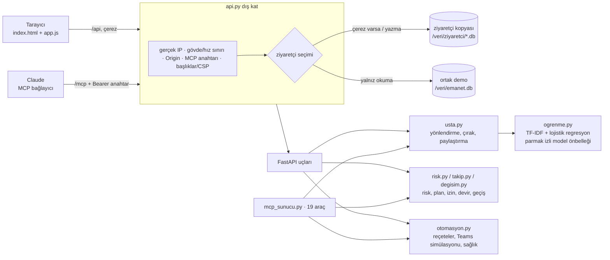

# Emanet + Usta: proje dokümanı

> Yaşayan doküman: kod değiştikçe aynı commit'te güncellenir. Derin anlatım ve 38+ soru:
> [HAKIMIYET.md](HAKIMIYET.md). Vaka anlatımı: [VAKA_NOTU.md](VAKA_NOTU.md). Ortak altyapı
> (Cloudflare, VPS, Docker, Caddy, yedek): ysfdurak.com deposu → `sunucu/README.md`,
> güvenlik kuralları → `docs/GUVENLIK_TEMELI.md`.

## 1. Bir bakışta

| | |
| --- | --- |
| **Ne** | Sistemsel destek çağrılarını geçmişten öğrenerek doğru kişiye yönlendiren (Usta) ve bu çağrılardan "kim giderse ne kırılır" haritası çıkaran (Emanet) uygulama |
| **Kimin için** | Depo/BT destek ekibi yöneticisi, İK ve eğitim birimi |
| **Canlı adres** | https://emanet.ysfdurak.com (25 Kasım 2026'da yayında) |
| **Depo** | https://github.com/ysfdurak/emanet (herkese açık; CI: testler + pip-audit) |
| **Durum** | Pilot, yayında. 83 test, güvenlik taraması temiz; MCP Claude'a bağlı |
| **Teknoloji** | Python 3.13, FastAPI, scikit-learn, SQLite, MCP, Docker |
| **Lisans** | PolyForm Shield 1.0.0 |

## 2. Sorun ve kararların

**Sorun:** Destek çağrıları çoğu zaman "en iyi bilen" kişiye gider; zamanla bilgi birkaç kişide toplanır.
O kişi izne çıkınca, ayrılınca ya da sistem değişince iş durur. Çağrı sistemleri sınıflandırır ama
bu bağımlılığı göstermez.

**Senin verdiğin kararlar** (mülakatın asıl konusu):

| Karar | Neden |
| --- | --- |
| Usta yalnız **sistemsel** çağrılara bakar (BT, WMS); teknik/bakım çağrıları ayrı sistemden gelir | Sahadaki çağrı merkezi zaten böyle ayrılmış; bakım dökümü Emanet'e ayrıca girer |
| Yönlendirme **makine öğrenmesiyle**: kime gitmiş, nasıl çözülmüş geçmişten öğrenilsin, çözene yol gösterilsin | Kural listesi eskiyor, geçmiş çağrılar bilgiyi zaten taşıyor |
| **Yetki çerçevesinde otomasyon**: kurulum talebinde eksik bilgi Teams'ten sorulsun, onay alınsın, kendisi kursun; altı akışın hepsi | Çağrıların bir kısmı tekrar eden basit işler |
| Değişimler de görülsün: **yeni otomasyon, yeni personel, yeni sistem** | Geçmişe bakan harita bu üç durumda yanılıyordu |
| Kişi modeli "kime verilirdi"yi değil **"kim iyi çözer"i** öğrensin | Aksi hâlde Usta, Emanet'in azaltmaya çalıştığı bağımlılığı besliyordu |
| Ziyaretçi **kendi çağrı verisini siteye yüklemesin**; gerçek veri yerelde denensin | Şirket verisi dışarı çıkmaz ilkesi |
| Usta ve Emanet **tek proje**, Emanet çatı adı | İki taraf aynı veriyi kullanıyor |

## 3. Mimari ve veri akışı



- **Tek çekirdek, iki kapı:** web ve MCP aynı fonksiyonları çağırır, kural tek yerde.
- **Veri:** SQLite. Demo her gece yeniden üretilir (`veri_uret.py`, sabit tohum). Gerçek veri için
  `yerel.py` boş bir veritabanına içe aktarır.

## 4. Teknoloji seçimleri

| Seçim | Neden | Elenen |
| --- | --- | --- |
| Python + scikit-learn | Model, optimizasyon ve analiz Python'da doğal; portföyün Python servis şablonuyla aynı | Node: ML kitaplıkları zayıf |
| Harf 3-5'li TF-IDF + lojistik regresyon | Türkçe ekler ve yazım hataları; yüzlerce-binlerce çağrıda en iyi denge, açıklanabilir, saniyede eğitilir | Derin öğrenme (veri az, açıklanamaz), büyük dil modeli (veri dışarı çıkar) |
| Model + açık kural (paylaştırma, çırak) | Model yetkinliği söyler, kime verileceğini kural söyler; kural okunabilir ve kapatılabilir | Olasılığı cezalandırmak: geçmiş atamalar yüzünden olasılık uzmanda yığılıyor, işe yaramadı |
| SQLite | Tek süreç, demo verisi; ziyaretçi kopyası tek dosya kopyalamak | Ortak PostgreSQL: gece silinen demo için gereksiz |
| Ziyaretçi başına veritabanı kopyası | Ziyaretçiler birbirinin metnini görmez; uçlar değişmeden (`ContextVar`) | Ortak tablo: herkes herkesin yazdığını görür |
| Dinamik programlama (eğitim planı) | Bütçeli seçim tam çözülür, açgözlü kurala göre farkı ölçülür | — |

## 5. Kod turu

| Dosya | Ne yapar | Dikkat |
| --- | --- | --- |
| `emanet/api.py` | Dış kat (güvenlik, ziyaretçi seçimi) + FastAPI uçları | `con` bir vekil nesne: her istekte o isteğin veritabanına yönlenir |
| `emanet/ogrenme.py` | Konu ve kişi modeli, kalite ağırlığı, paylaştırma kuralı, zaman bazlı değerlendirme | Önbellek anahtarı verinin parmak izi; değerlendirme bugünden önceki çağrılarla |
| `emanet/usta.py` | Konu önerisi, yönlendirme (izin, vardiya, çırak, paylaştırma), çağrı açma/kapatma | Kapanan (geçişli) konuya çağrı açılamaz |
| `emanet/otomasyon.py` | 8 reçete, Teams akışı, toplu arıza, kapanış teyidi, sağlık ve askıya alma | Yer yazılmamış çağrı yalnız yer yazılmamışlarla birleşir |
| `emanet/risk.py` | Risk puanı, ya giderse, eğitim planı, tek kişiye kalanlar, veri tazeliği | Formül dosyanın başında |
| `emanet/takvim.py` | Eğitim planını haftalara ve günlere yerleştirir (saf işlev) | Kişi başı haftalık ve günlük sınır hem vereni hem alanı kapsar; açgözlü yerleştirme, en riskli konu önce |
| `emanet/takip.py` | İzin kontrolü, plan takibi, devir dosyası, risk seyri, dikkat listesi | |
| `emanet/degisim.py` | Sistem geçişi, yeni personel, ayrılış | |
| `emanet/yerel.py` | Kendi verinle yerel kurulum ve rapor | Demo veritabanının üzerine yazmaz |
| `emanet/gercek_ip.py` | Gerçek IP yalnız güvenilen vekilden | Python servis şablonundan |
| `web/app.js` | Bütün ekranlar | Her değer `kac()` ile kaçışlanır; satır içi betik yok |

Akış örneği, "Çağrıyı aç": `app.js` → `POST /api/cagri` → dış kat (sınırlar, Origin, ziyaretçi
kopyası) → `usta.cagri_ac` → `toplu_kontrol` → `yonlendir` (model + kurallar) → `otomasyon.baslat` →
kayıtlar → JSON → ekran.

## 6. Sunucu ve yayın

Ortak altyapıdaki yeri: ysfdurak.com PR #55 (`sunucu/kurulum-emanet.sh`, Caddy bloğu, tarama listesi).
Ayrıntı: [deploy/KURULUM.md](../deploy/KURULUM.md).

1. GitHub'da `ysfdurak/emanet` deposu → kod gönderilir → dal koruması.
2. ysfdurak.com PR #54, sonra #55 birleşir.
3. Cloudflare: `emanet` A kaydı, turuncu bulut.
4. VPS: `bash ~/ysfdurak.com/sunucu/kurulum-emanet.sh` (MCP anahtarını kendisi üretir).

Ortam değişkenleri: `.env.example`. Önemlileri: `EMANET_MCP_ANAHTARLARI`, `EMANET_ZIYARETCI`,
`EMANET_DB` (kendi verinle).

## 7. Testler

`python -m pytest -q`: 83 test (model, risk, otomasyon, değişimler, paylaştırma, yerel kurulum, API
güvenliği, MCP). CI'da aynı testler ve `pip-audit`.

**Örneklem (24 Kasım 2026, yerel sunucu, mobil 390 px Chrome):**

| Adım | Beklenen | Gözlenen | Durum |
| --- | --- | --- | --- |
| 13 ekranı sırayla aç | Hata yok, CSP ihlali yok | Konsol temiz | ✅ |
| Geçiş + yeni personel + bozulma demoları | Kartlar görünür, reçete askıda | Görüldü | ✅ |
| İkinci tarayıcıdan aynı ekran | Birincinin geçişini görmez | Görmedi | ✅ |
| "Kendi demo alanımı sıfırla" | Alan başa döner | Döndü | ✅ |
| Dökümde `">` adlı kişiler | Betik çalışmaz, metin olarak görünür | Çalışmadı, metin göründü | ✅ |
| Anahtarsız `/mcp` | 401 | 401 | ✅ |
| Başka siteden POST (Origin) | 403 | 403 | ✅ |
| `tara.py --audit` (#54 sürümü) | Temiz | Temiz | ✅ |
| Sunucuda bellek (`docker stats`, boşta) | < 500 MB | 120,9 MiB / 768 MiB, CPU %0,28 | ✅ |
| Claude özel bağlayıcı (başlıkta anahtar) | Araç çağrılır, veri gelir | "En riskli konu" → ERP entegrasyon hatası, 100 puan | ✅ |
| Canlı adreste başlıklar (`curl -sI`) | CSP, HSTS | İkisi de geldi | ✅ |
| İki telefon (canlı) | Biri ötekinin çağrısını görmez | Görmedi | ✅ |

**Burada bir test daha yapalım:** boştaki 121 MiB, modeller henüz eğitilmeden ölçüldü. Birkaç
ziyaretçi gezdikten sonra `docker stats emanet --no-stream` bir kez daha bakılmalı (250–350 MB
normal; 768 MB sınırına yaklaşırsa model önbelleği 6'dan 3'e indirilir).

**Ders (yayın günü):** MCP anahtarı ilk denemede bağlayıcı adresine yazılıp ekran görüntüsüyle
paylaşıldı; anahtar hemen yenilendi. Doğrusu: adres `https://emanet.ysfdurak.com/mcp`, anahtar
**İstek başlıkları** bölümünde `Authorization: Bearer <anahtar>`. Başlık değeri Claude'da şifreli
saklanır ve bir daha gösterilmez; adres ise ekranda, kayıtlarda ve ekran görüntülerinde görünür.
Anahtar yenileme:
```bash
cd ~/emanet && sed -i "s|^EMANET_MCP_ANAHTARLARI=.*|EMANET_MCP_ANAHTARLARI=$(openssl rand -hex 32)|" .env
bash ~/ysfdurak.com/sunucu/kurulum-emanet.sh
```

## 8. Bilinen sınırlar ve sonraki adımlar

- Sentetik veride başarı yüksek (konu %91); gerçek veride düşük çıkabilir: `python -m emanet.yerel` ile ölç.
- Otomasyonlar simülasyondur (Teams, Intune, Active Directory bağlantısı yok).
- Paylaştırma ve kalite ağırlığının etkisi demo verisinde küçük (bkz. HAKIMIYET 2b).
- **Şöyle daha iyi olur:**
  - Arıza Defteri yayına çıkınca bakım dökümü elle yüklemek yerine oradan okunabilir (Caddyfile'da
    bu bağlantı için not var).
  - Gerçek veri gelince anlam benzerliği için yerel bir cümle modeli eklenebilir.
  - Ziyaretçi demosundaki model eğitimi isteği bekletiyor (ilk kapanışta 1-2 sn); arka plana alınabilir.

### Gerçek Teams bağlantısı nasıl kurulur?

Demoda Teams, uygulamanın içindeki "Teams kutusu"dur: mesajlar `mesaj` tablosuna yazılır, cevabı ekrandan sen
verirsin. Kod bunu gerçeğe bağlanacak şekilde üç noktada ayırdı; yalnız bu üç nokta değişir, akış aynı kalır:

| Nokta | Demoda | Gerçekte |
| --- | --- | --- |
| Giden mesaj: `otomasyon._mesaj()` | Tabloya yazar, Teams kutusunda görünür | Ayrıca Teams'e **uyarlanabilir kart** (Adaptive Card) gönderir: metin + "Onayla / Reddet" ya da seçenek düğmeleri |
| Gelen cevap: `otomasyon.cevapla()` ← `POST /api/mesaj/{id}/cevap` | Ekrandaki düğme çağırır | Teams'teki düğmeye basılınca Microsoft tarafı bu adrese cevabı yollar |
| İşin kendisi: `otomasyon._calistir()` | Başarıyı rastgele üretir | Kurumun aracını çağırır: Intune (yazılım kurulumu), Active Directory / Entra ID (yetki, şifre sıfırlama) |

**İki kurulum yolu var; önerim birincisi:**

1. **Power Automate onay akışı (az kod, BT'nin bildiği yol).** Emanet, onay gerektiğinde Power Automate'teki
   bir akışın HTTP tetikleyici adresine istek atar. Akış "Onay başlat ve bekle" adımıyla yöneticiye Teams'te
   onay kartı gösterir; cevap gelince Emanet'in cevap adresine geri yazar. Emanet'te gereken: dışa giden tek
   bir HTTP isteği ve cevap adresinde **imza denetimi** (paylaşılan gizli anahtarla HMAC; böylece cevabı
   yalnız akış yazabilir, kimse URL'yi tahmin edip "Onayla" diyemez).
2. **Teams botu (Bot Framework, iki yönlü sohbet).** Çağrı açan kişiyle soru-cevap (eksik bilgi sorma) da
   Teams'te olur. Daha güçlü ama Azure'da uygulama kaydı, bot hizmeti ve yönetici onayı ister; ilk sürüm için ağır.

**Gerçek kurulumun ön koşulları (kullanıcının işi, kod değil):** kurum BT onayı; Entra ID'de uygulama kaydı
ve yalnız gereken izinler (en az yetki); otomasyonun çalıştığı **servis hesabı** ve her adımın denetim kaydı
(zaten var: `oto_adim`). Şirket verisi dışarı çıkmamalı: Emanet bu durumda **kurumun kendi sunucusunda**
çalışır, VPS'teki demo değil. Yapay zekâ çağrısı yok; Teams yalnız mesaj taşır.

**Şöyle daha iyi olur:** gerçeğe geçmeden önce `_mesaj` ve `cevapla` için bir "kanal" arayüzü (demo kanalı /
Teams kanalı) tanımlamak; demo ve gerçek aynı kodu kullanır, testler demo kanalıyla çalışmaya devam eder.

### Kullanıcı gözüyle sadeleştirme (25 Kasım 2026)

13 sekme kullanıcının sorusuna göre değil, kodun parçalarına göre ayrılmıştı ("USTA", "EMANET" ürün adları
ilk gelen için anlamsız; telefonda 13 sekmeden 4'ü görünüyordu). Yeni düzen:

| Ana alan | İçinde | Cevapladığı soru |
| --- | --- | --- |
| Bugün | Yapılacaklar listesi + 3 hızlı giriş; tur ve sayılar açılır bölümde | Bugün neye bakmalıyım? |
| Çağrılar | Çağrı aç · Kuyruk · Çözüm notları · Otomatik çözümler | Bir sorunum var / ne bekliyor? |
| Riskler | Risk haritası · Biri yoksa (tarihli izin + ayrılık tek ekranda) | Kim neye bağlı, biri yoksa ne olur? |
| Eğitim | Plan ve takvim | Bunu nasıl düzeltirim, ne zaman? |
| Daha fazla | Değişimler · Kendi verinle dene · Nasıl çalışır · Model nasıl öğreniyor | Ayrıntı ve kurulum |

Sayfa adresleri (#risk, #plan…) değişmedi; eski bağlantılar, dokümandaki yollar ve "Bugün neye bakmalı?"
düğmeleri çalışmaya devam eder. Ana menü son ziyaret edilen alt sekmeyi hatırlar. "Git" düğmeleri eylem
adı aldı ("Ne olur, gör", "İzinlere bak"). Aynı turda bulunan bir hata: `.kucuk` hem küçük düğme hem soluk
açıklama metni sınıfıydı, bu yüzden koyu küçük düğmelerin yazısı griydi (Teams kartındaki "Evet, çözüldü").

**Sıradaki adımlar (önerildi, sırayla):** sayfa içleri (kısa giriş + ilk ekranda eylem; Risk haritası
varsayılan olarak en riskli 5 konu, matris ve seyir açılır bölümde), sonra kelimeler (reçete → otomatik
çözüm, yetkin → bilen, çırak → yanında öğrensin) ve demo düğmelerinin tek "Demo" şeridine toplanması.

### Pilot bitiş ölçütleri (dış kaynak olmadan)

Dördü de sağlanınca durum "Tamamlandı" olur; siteye proje sayfası ve Rota girdisi eklenir.
Hiçbiri başka kişiye ya da şirket verisine bağlı değil.

| # | Ölçüt | Nasıl bakılır | Hedef |
| --- | --- | --- | --- |
| 1 | Canlıda 14 gün kararlı (9 Aralık 2026'ya kadar) | `docker inspect emanet --format '{{.RestartCount}} {{.State.StartedAt}}'` ve `docker stats emanet --no-stream` | Yeniden başlama 0, bellek < 500 MB, gece sıfırlaması her gün |
| 2 | Model zor veride de ayakta | Gürültülü sentetik veri: yazım hatası, kısa metin, %15 yanlış etiket; `python -m emanet.yerel` ile içe aktarılıp model ekranında ölçülür | Konu ≥ %75, kişi ilk üçte ≥ %80 |
| 3 | İlk kez gelen biri yardımsız kullanır | Claude temiz tarayıcıyla 5 görev: en riskli konu, ya giderse, çağrı aç, devir dosyası, eğitim planı. Takılınan her yer düzeltilir | 5 görevin 5'i sayfa dışı açıklama olmadan |
| 4 | Proje sana geçti | Bölüm 11'deki 5 dakikalık demo ve Bölüm 10'daki soruların 10'u, bakmadan | Demo akıcı, 10 sorudan en az 8'i doğru |

**Durum (25 Kasım 2026):** 2 ve 3 tamam; 1 ve 4 süreye bağlı (9 Aralık).

**Ölçüt 2 — gürültü testi** (`python -m araclar.gurultu_testi`, ayrıca `tests/test_gurultu.py`).
Yanlış etiket yalnız eğitime konuldu, test etiketleri doğru: "kirli geçmişten öğrenen model yeni
çağrıda doğruyu buluyor mu?" ölçülür.

| Senaryo | Konu | Kişi 1. sırada | Kişi ilk 3 |
| --- | --- | --- | --- |
| Temiz | %90,6 | %63,3 | %92,2 |
| Yazım hatası %40 | %91,1 | %61,1 | %92,2 |
| Kısa metin %30 | %87,2 | %61,7 | %93,9 |
| Yanlış etiket %15 | %86,1 | %62,8 | %94,4 |
| **Hepsi birlikte (ölçüt)** | **%80,6** | %59,4 | **%88,9** |
| Sert (etiket %25, yarısı kısa) | %70,6 | %47,8 | %89,4 |

Karşılaştırma tabanı: rastgele 3 kişi %50, "konuda en çok çözen 3 kişi" kuralı %69. Yani ilk 3'teki
%89 birimlerin küçük olmasından gelen bir kolaylık değil; model kuraldan 20 puan önde.
Yazım hatası neredeyse hiç etkilemiyor: model sözcük yerine 3–5 harflik parçalara baktığı için
(`char_wb`) "termnal" ile "terminal" büyük ölçüde aynı parçaları paylaşıyor. En çok zarar veren
yanlış etiket ve kısa metin. **Şöyle daha iyi olur:** gerçekte en sık yanlışlık kısa metin
("sistem çalışmıyor") olduğundan, emin olmadığında soru sorma eşiği (`SORU_ESIGI`) zaten bunu
yakalıyor; sert senaryoda konu %71'e düştüğü için soru oranı gerçek veride izlenmeli.

**Ölçüt 3 — ilk kez gelen kullanıcı** (temiz tarayıcı, 390 px, yardım metni okunmadan):

| Görev | Yol | Sonuç |
| --- | --- | --- |
| En riskli konu | Bugün sayfasında "Bugün neye bakmalı?" ilk satır | ✅ ilk ekranda |
| Ya giderse | Ana sayfa "Simülasyonu gör" ya da sekme | ✅ (sekmeden boş geliyordu → düzeltildi) |
| Çağrı aç | Sekme → metin yaz → konu, kişi, çözüm kartı canlı | ✅ |
| Devir dosyası | Ya Giderse → "Devir dosyası hazırla" → Markdown indir | ✅ |
| Eğitim planı | Ana sayfa "Planı çıkar" | ✅ (karşılaştırma notu çelişkiliydi → düzeltildi) |

Bulunan ve düzeltilen üç takılma:
1. **Ya Giderse sekmeden açılınca boş sayfa:** artık en riskli konunun ustasıyla hesaplanmış gelir,
   "örnek olarak seçildi" notu görünür.
2. **Sekme şeridinde 13 sekme var ama telefonda 4'ü görünüyor, kaydırılabildiği anlaşılmıyordu:** sağ
   kenar soluklaşır (CSS `mask-image`), sona gelince solma kalkar; seçili sekme görünür alana kayar.
3. **Plan karşılaştırması:** dar ekranda tablo kesiliyordu, satırlara çevrildi. Not "optimizasyon
   hiçbir zaman kötü çıkmaz" diyordu ama ekranda kuralın risk düşüşü daha büyüktü (302 / 290). Not
   düzeltildi: üstünlük amaç puanında; kural yeşil konuları da düşürdüğü için toplamı şişirir.

4. **"Planı çıkar" çalışmıyor gibi görünüyordu (canlıda kullanıcı fark etti):** sayfa açılırken plan zaten
   hesaplanıyor; düğme aynı planı yeniden hesaplayınca ekranda hiçbir şey değişmiyor, geri bildirim de
   yoktu. Hata değil, sessizlikti. Artık düğme "Hesaplanıyor…" der, bitince bildirim gösterir ve sonuca
   kaydırır (`dugmeyleHesapla`). Ya Giderse'deki "Hesapla" da aynı yardımcıyı kullanır.

5. **Plan ekrandan anlaşılmıyordu (canlıda kullanıcı söyledi):** plan adım adım listeleniyordu; aynı konu
   üç satırda tekrar ediyor, her satırda konunun *son* puanı (100 → 22) yazıyordu. Okuyan "bu tek adım
   mı 22'ye indiriyor?" diye kalıyordu. Artık başta düz cümleyle **"Bu plan ne diyor?"** özeti var,
   adımlar **konu konu** toplanıyor (`planKonulari`) ve her adım cümle olarak yazılıyor (`planCumlesi`:
   "Murat Özkan, eskiden bu işi yapan Emre Çelik kişisinin bilgisini tazeler"). Türkçe ek için ondalık
   sayıda virgülden sonraki kısma bakan `sek()` eklendi ("25,2'den").
6. **Bildirim telefonda gözden kaçtı:** sonuç kutusunda "Hesaplandı: saat" yazıyor ve kutu kısa bir süre
   sarı vurgulanıyor; geri bildirim artık yalnız alttaki bildirime bağlı değil.

7. **"Burada ne yapıyoruz?" (canlıda kullanıcı sordu):** sayfa hesap ayrıntısıyla açılıyordu. Başlık
   "Eğitim planı" oldu, altında tek cümle amaç var; adım türleri ("Plan hangi adımları kullanır?") ve
   yöntem karşılaştırması ("Nasıl hesaplandı?", teknik ayrıntı) varsayılan kapalı açılır bölümlere
   taşındı. Ekran artık üç soruyu cevaplıyor: ne yapılacak, kim yapacak, sonunda ne değişecek.
   Karşılaştırma silinmedi; mülakatta "optimizasyonu neden kullandım" sorusunun kanıtı o.
8. **Masaüstünde sekme şeridi kayıyordu:** seçili sekmeyi görünür yapma kodu geniş ekranda şeridi sağa
   itip "Genel Bakış"ı gizliyordu. 900 px üstünde sekmeler iki satıra sarılıyor; kaydırma ve solma
   yalnız telefonda.

9. **"Çok eğitim planı gibi durmuyor" (kullanıcı):** ekran ne yapılacağını söylüyor ama ne zaman ve kimin
   saatinden olduğunu söylemiyordu; depoda personel iş varken uzun süre eğitime çekilemez. Takvim eklendi
   (`takvim.py`): kişi başı haftalık sınır, oturum süresi, günlük oturum, çalışma günleri ve başlangıç
   ayarlanabilir; hafta hafta görünüm, kişi kişi yük, Excel'e indirme. Konu konu görünüm üçüncü sekmeye geçti.

10. **"Daha dinamik olsun" (kullanıcı):** takvim hesaplanıp bırakılıyordu. Artık her hafta kartında
    **ötele** (o hafta eğitim yok, oturumlar kayar), **kişi başı saat −/+** (yalnız o hafta) ve **"bu hafta
    yok"** (izindeki kişi) var. Değişiklikler üstte geri alınabilir etiketler olarak durur; Excel çıktısı
    değiştirilmiş takvimi verir. Hafta numarası başlangıca göre sabittir: 2. haftayı ötelersen 3. hafta
    yine 3. haftadır, bu yüzden değişiklikler takvim kaysa da doğru haftada kalır. Takvim ayarları
    başlangıçta açık. **Sınır:** değişiklikler sayfa yenilenince sıfırlanır (kalıcı hali Excel);
    **şöyle daha iyi olur:** "Bu planı kaydet" takvim değişikliklerini de saklasın.
11. **"Şu tarihe ya da şu kadar haftaya kadar ötele" (kullanıcı):** her hafta kartında "Durdur ya da izin
    ekle" bölümü: kim (herkes ya da bir kişi) ve ne kadar (1–4 hafta ya da "şu tarihte yeniden başla").
    Sunucu değişmedi: aralık, istemcide hafta hafta açılıp aynı `hafta_sinir` ve `kisi_yok` listelerine
    yazılır. Etiketler ardışık haftaları tek aralıkta toplar (`araliklar()`: [2,3,4,7] → 2–4 ve 7) ve
    tarihleriyle gösterir: "Eğitim durdu: 2.–4. hafta (7 Aralık – 25 Aralık) ✕". Bir tıkla bütün aralık
    geri alınır. Takvim hafta hafta çalıştığı için seçilen tarihin düştüğü hafta yeniden başlama haftasıdır.

Ders: 13 ekranın hepsi "hata yok, CSP yok" testinden geçmişti; bu üç sorunu teknik test değil,
görev odaklı bakış buldu.

## 9. Mülakat soruları

1. **Neden büyük dil modeli değil de klasik makine öğrenmesi?** Veri azken daha iyi ya da eşit, açıklanabilir, saniyede eğitilir, şirket verisi dışarı çıkmaz.
2. **Modelin isabeti %63 ise iyi mi?** Etiket "kim çözdü"; bu kime verildiğini de yansıtır. İlk üçte %92, eski kural %69. Asıl ölçü "bilene gitti mi, bilgi dağıldı mı".
3. **Risk puanı nasıl hesaplanıyor?** Yoğunlaşma, yedek riski, yazısızlık ve kritiklik; otomasyon payı bağımlılık kısmını azaltır. Formül ekranda.
4. **Ziyaretçiler neden birbirini görmüyor?** İlk değişiklikte kendi kopyası açılır, çerezle tanınır; 24 saatte silinir.
5. **Güvenlik için ne yaptın?** CSP ve başlıklar, Origin denetimi, sınırlar, gerçek IP, anahtarlı MCP, sabit ve özetli bağımlılıklar, salt okunur konteyner; haftalık otomatik tarama.
6. **Yeni sistem geldiğinde ne olur?** Eski konu kapanır, yeni konunun puanı ilk 60 gün geçicidir, bilgi tek kişide toplanırsa erken uyarı.

7. **Eğitim takvimi nasıl çıkıyor, neden en kısa takvimi aramıyorsun?** Plan "hangi adımlar", takvim "ne zaman"
   sorusunu cevaplar. Adımlar oturumlara bölünür ve iki sınırla yerleşir: kişi başı haftalık saat ve günlük
   oturum. Açgözlü yerleştirme en kısa takvimi garanti etmez ama "en tehlikeli iş önce" kuralını korur ve
   sonucu bir amirin kafasında yeniden yapabileceği kadar basittir. Takvimin uzunluğunu genelde tek kişi
   belirler (darboğaz); ekran onu adıyla gösterir: "Süreyi Kemal belirliyor".

Daha fazlası: HAKIMIYET.md, 1–38. sorular.

## 10. Kendini test et

<details><summary>1. Ziyaretçi bir çağrıyı yalnız okurken neden kopya açılmaz?</summary>
Okuma isteği ortak demoyu değiştirmez; her bot ve gezgin için dosya açmak diski ve belleği doldururdu.
Kopya ancak bir şey değiştiren ilk istekte açılır.</details>

<details><summary>2. Model önbelleği neden veritabanına değil verinin parmak izine bağlı?</summary>
Dokunulmamış 300 kopya aynı veriyi taşır; parmak izi aynı olduğu için tek model yeter. Bellek 768 MB.</details>

<details><summary>3. uvicorn neden vekil başlıklarını yorumlamıyor?</summary>
`X-Forwarded-For` herkes tarafından yazılabilir; yalnız güvenilen vekilden geliyorsa `gercek_ip.py`
okur. Aksi hâlde hız sınırı başlık değiştirilerek atlatılırdı.</details>

<details><summary>4. Sayfada neden satır içi betik yok?</summary>
CSP `script-src 'self'` olabilsin; araya sızan bir HTML parçası betik çalıştıramasın.</details>

<details><summary>5. Paylaştırma sipariş dalgasında neden devreye girmez?</summary>
Vardiyada konuyu bilen ikinci kimse yok; yetkinliği olmayan birine çağrı verilmez. Çare eğitim planı.</details>

<details><summary>6. Haftalık sınır neden eğitim verene de uygulanıyor?</summary>
Veren de o saatte işinin başında değil. Üstelik veren genelde tek bilen usta; onun saati en kıt kaynak.
Sınır yalnız alana uygulansaydı Kemal haftada 9 saat eğitime çekilir, sorter arızasında kimse kalmazdı.</details>

<details><summary>7. Varsayılan ayarlarla takvim 9 hafta; nasıl kısaltırsın?</summary>
Darboğaz Kemal (18 saat). Haftalık sınırı 4 saate çıkarmak takvimi 5 haftaya indirir; ya da sorter
öğretimini iki ustaya bölmek. Bütçeyi azaltmak da kısaltır ama riski daha az düşürür.</details>

<details><summary>8. 2. haftayı öteledin; değişiklik neden 3. haftaya kaymıyor?</summary>
Hafta numarası takvimin başlangıcına göre sabit (`hafta_sinir={2: 0}`), oturumların sırasına göre değil.
Değişiklik "takvimin 2. haftası" demek; oturumlar kayar ama haftalar kaymaz. Aksi hâlde her değişiklik
öncekileri yanlış haftaya taşırdı.</details>

## 11. Elle yapılacak alıştırma

**Kod:** `emanet/ogrenme.py` içinde `PAY_ESIGI = 0.60` değerini `0.70` yap. `python -m pytest -q
tests/test_politika.py` çalıştır, sonra uygulamada Öğrenme ekranındaki "Model + paylaştırma"
satırının nasıl değiştiğine bak. Değeri geri al.

**5 dakikalık demo akışı:**
1. Genel bakış: "Bugün neye bakmalı?" listesi (1 dk).
2. Çağrı aç: "Sipariş dalgası açılmıyor", gece vardiyası → bilen tek kişi gündüzde (1 dk).
3. Ya giderse: Elif Kaya → hangi konular yedeksiz kalır, devir dosyası (1 dk).
4. Eğitim planı: 60 saat → risk ne kadar düşer (1 dk).
5. Değişimler: geçiş örneği → erken uyarı; "neden kendi veriniz siteye yüklenmiyor" (1 dk).

## 12. Değişiklik günlüğü

| Tarih | Değişiklik |
| --- | --- |
| 15 Kasım 2026 | Kapsam belgesi: Emanet + Usta tek proje |
| 16 Kasım 2026 | İlk sürüm; makine öğrenmesi; altı otomasyon; Emanet'e altı ekleme; değişimler ve denetim; kişi modeline kalite ağırlığı ve paylaştırma; yerel kurulum |
| 24 Kasım 2026 | Güvenlik temeli: PolyForm Shield, ziyaretçi başına veri kopyası, CSP (sayfa üç dosyaya ayrıldı), Origin denetimi, gövde ve hız sınırları, gerçek IP, `/docs` kapalı, anahtarlı MCP, CSV formül enjeksiyonu, öznitelik kaçışı, sabit ve özetli bağımlılıklar, Python servis şablonuna uygun Docker/compose, CI ve dependabot; ysfdurak.com PR #55; bu doküman |
| 25 Kasım 2026 | Depo açıldı ve gönderildi; dependabot: Python imajında yalnız yama sürümleri, pytest 9.2; VPS'e kuruldu; Claude bağlayıcısı başlıkta anahtarla bağlandı; MCP anahtarı yenilendi (bkz. Testler: Ders) |
| 25 Kasım 2026 | Pilot bitiş ölçütleri; gürültü testi (ölçüt 2 geçti); ilk kullanıcı testi (ölçüt 3 geçti, 3 düzeltme) |
| 25 Kasım 2026 | Hesap düğmelerine geri bildirim ("Planı çıkar" sessiz kalıyordu) |
| 25 Kasım 2026 | Plan ekranı konu konu, düz cümle özetli; sonuç vurgusu ve hesap saati |
| 25 Kasım 2026 | Eğitim planı sadeleşti (amaç cümlesi, açılır teknik bölümler); masaüstünde sekmeler sarılıyor |
| 25 Kasım 2026 | Eğitim takvimi: parametrik (haftalık sınır, oturum, gün, başlangıç), darboğaz kişi, CSV, MCP aracına takvim; 100 test |
| 25 Kasım 2026 | Takvimde elle değişiklik: hafta ötele, haftaya özel saat, kişi o hafta yok; geri alınabilir etiketler; ayarlar açık |
| 25 Kasım 2026 | Takvimde süreli öteleme ve izin: 1–4 hafta ya da tarihe kadar, aralık etiketleri |
| 25 Kasım 2026 | Menü 4 alan + Daha fazla; Biri yoksa (izin + ayrılık); Bugün sayfası; küçük düğme kontrastı; Teams gerçek bağlantı notu |
